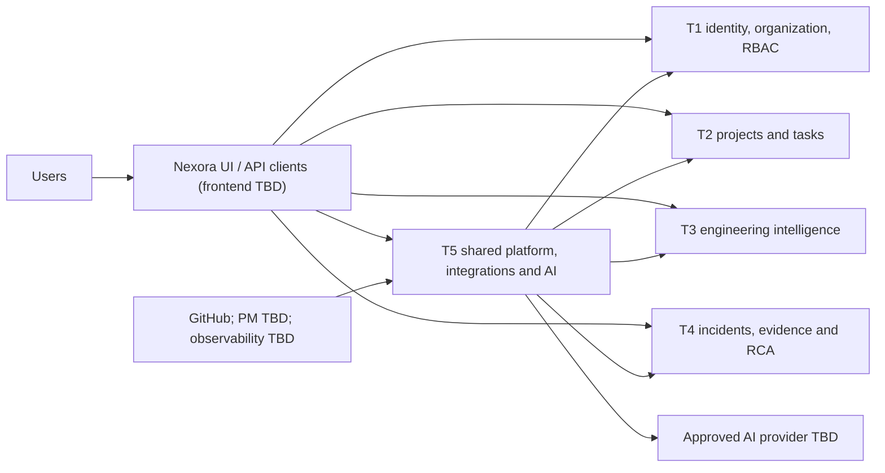
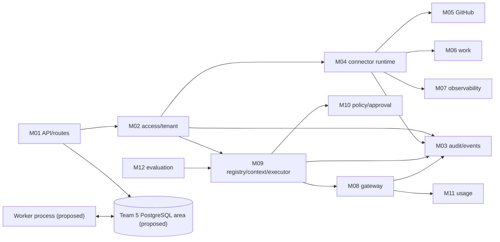
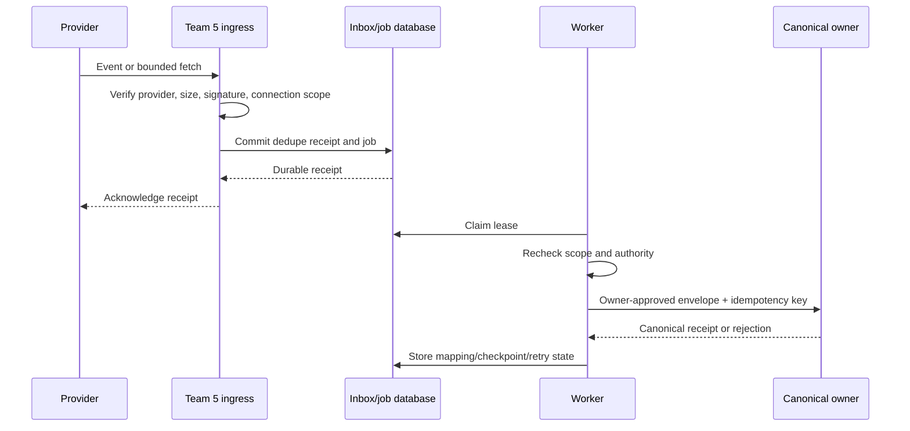
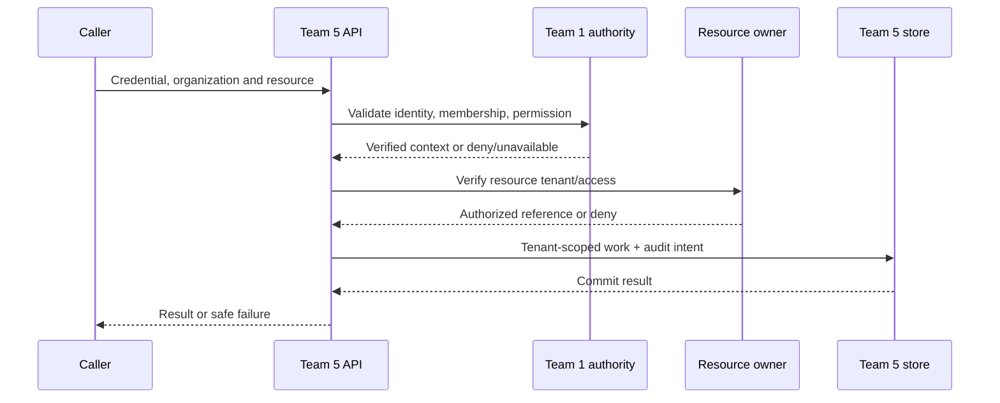
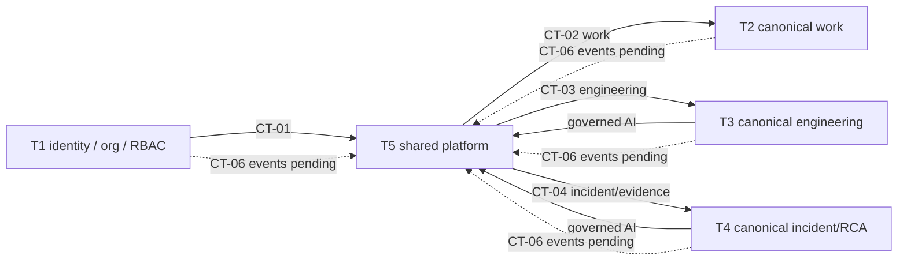
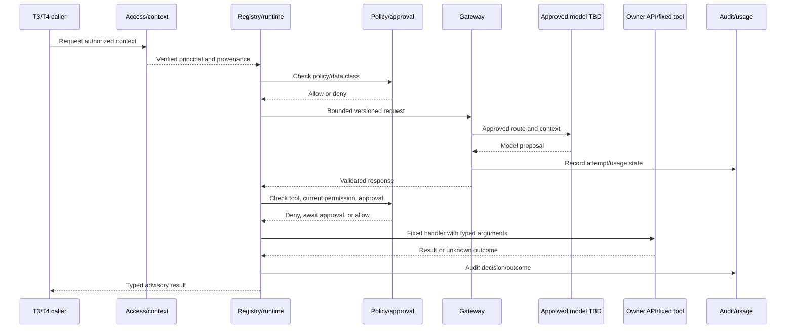
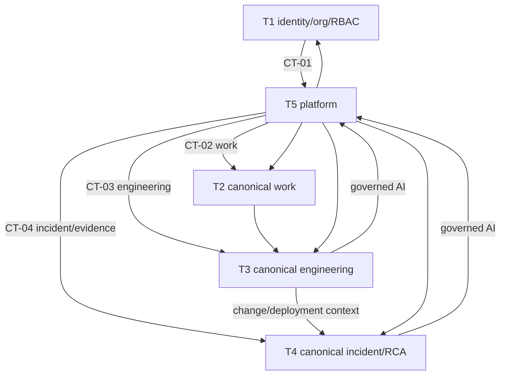

# Nexora Project Master Document

**Purpose:** Onboarding reference for developers, technical leads, and stakeholders.  
**Evidence baseline:** Supplied Team 5 documentation pack, v0.1, 27 October 2026.  
**Status:** Source synthesis, not approval or implementation evidence. “Confirmed” means source-supported, not built or release-approved. Team 5 designs are generally proposed pending Q01–Q16.

## 1. Project Overview

### In simple terms
Nexora connects information normally kept apart: organizational ownership, planned work, code changes, deployments, and production incidents. Authorized developers and investigators can follow the path from work intent to change and operational outcome.

### Technical view
Nexora is a multi-team engineering intelligence platform. Teams 1–4 own organization/identity, work, engineering, and incident/RCA records. Team 5 provides shared access enforcement against Team 1 authority, integrations, audit/events, governed AI gateway/execution, usage, and evaluation infrastructure. The product overview names FastAPI and PostgreSQL at high level. A modular API/worker and PostgreSQL-backed durable work are proposals, not approved deployment facts. [PRD §§2–3; architecture §§1–2,4]

**Problem:** organizational, work, code, delivery, runtime, and incident evidence is fragmented. Independent connectors/model clients can duplicate credentials, errors, costs, and access decisions; unrestricted AI could turn incomplete or hostile input into unsafe action. [PRD §3; source-inventory.md S01/S06]

**Objective/value:** reusable, authorized cross-domain context; change-impact and incident investigation; AI that is permission-checked, policy-governed, auditable, and reviewable. The intended result is explainable understanding and safer proposed remediation, not autonomous delivery authority. No adoption, revenue, incident-time, latency, availability, or cost-saving baseline is given. [PRD §3.2; S01 pp5–15]

**Actors:** organization integration administrator, developer/engineering reviewer, incident investigator/reviewer, audit reviewer, platform operator, Teams 1–4 services, connector worker, AI agent, external provider/webhook sender, QA/domain evaluator. These are personas, not approved RBAC roles. [PRD §4]

## 2. Business Requirements and Problem Statement

Nexora addresses fragmented organizational, work, code, deployment, runtime, and incident evidence through canonical domain owners and shared infrastructure. It is not a complete HRMS, Jira clone, duplicate engineering store, or alternate incident/RCA system. [PRD §§3,5]

Objectives: (1) Team 1 principal accesses only authorized resources; agents have no extra authority. (2) Agreed GitHub delivery reaches Team 3 canonically with safe replay. (3) Domain agents use gateway/registered tools and denied actions have no side effect. (4) Requests, executions, and audit outcomes correlate. (5) Authorized consumers reconcile attempts, known tokens and estimated cost, preserving unknowns. (6) Teams use contract fixtures before providers exist. [PRD §3.2]

Functional requirements are FR-PLAT-001–016, FR-SEC-001–003, FR-REL-001, FR-DATA-001 and FR-OPS-001, covering foundation, access/tenant, audit, connectors, AI, events, security, recovery, data integrity and operations. [PRD §6; architecture §3]

Confirmed non-functional themes: least privilege, tenant isolation, auditability, evidence-grounded AI, human review, vendor-independent canonical models and normal IDE/Git workflow. Detailed bounds/redaction/retry/recovery controls are proposed. Numeric performance, availability, retention, RPO/RTO and support targets are absent (Q09/Q10/Q14). Benefits are goals, not measured outcomes. [PRD §§8–9; security §§1–6]

## 3. Complete System Overview

The pack describes five product areas/shared foundation, but focuses on Team 5. No frontend specification or deployed service is evidenced.

1. **T1:** organization and identity—organization, department, team, employee, reporting/organizational roles and allocations; current coordinator also assigns identity/authentication/RBAC authority here.
2. **T2:** canonical projects, epics, tasks/subtasks, assignment/workflow and later collaboration/planning capabilities.
3. **T3:** canonical repositories, Git changes, builds/deployments, work-code links, metrics and change intelligence.
4. **T4:** incidents, timeline/evidence, evidence engine, RCA, candidates, remediation, validation and human review.
5. **T5:** shared foundation/access enforcement, audit/events, connectors, AI gateway/registry/runtime/policy, metering/evaluation.

Data path: verified Team 1/resource-owner access → external provider through Team 5 connector → bounded, mapped delivery to domain owner API → owner validation and canonical persistence. Domain agents use owner-authorized context and registered tools. Team 5 stores connection/job/mapping and technical execution state, not duplicate domain masters. [architecture §§2,7–12]

Examples include GitHub; Jira, Linear, Azure DevOps; Sentry, Datadog, PagerDuty, Prometheus, OpenTelemetry; and an unselected AI provider. Mention does not approve selection. [architecture §2.1]

## 4. Team Responsibilities and Ownership

Ownership is system-of-record/business authority, not physical deployment. Current coordinator direction supersedes old auth/RBAC assignments to T5.

| Team | Owns / delivers | Dependencies and contribution |
|---|---|---|
| **T1 — HRMS/organization and identity** | Organizations, users, auth, RBAC per current direction; departments, teams, employees, reporting/organizational roles and allocations. Supplies canonical identity, membership, permission and org context. | All teams consume; T2 project refs; T5 consumes/enforces CT-01. |
| **T2 — Project/task management** | Canonical project/work records and owner APIs; validates external imports if agreed. | T1 org/people refs; supplies work context to T3/T4/T5. |
| **T3 — Engineering productivity/change intelligence** | Canonical engineering records, links, metrics, impact and analysis. | Uses T1/T2; supplies T4 context; consumes T5 transport/access/AI. |
| **T4 — Incident/RCA** | Incident/evidence interpretation, RCA, remediation, validation and review/history. | Uses T1–3 context and T5 connector/AI/access/audit. |
| **T5 — Platform, integrations and AI** | Shared foundation, connector lifecycle/state, audit/events, gateway/registry/runtime/policy, usage/evaluation infrastructure. | Depends on T1 authority and T2–4 contracts; serves all, owns no canonical domain data, identity authority or domain reasoning. |

Sources: PRD §5; architecture §§1,3,7; source-inventory ownership matrix. T5 staffing names Sagar, Varshini, Sharanbasava; spelling/QA identity questions remain Q16.

## 5. Module-by-Module Explanation

### 5.1 Team 1–4 domain modules

The local Team 5 pack summarizes original specs; it does not supply every field-level contract. All statuses below are source priorities, not implementation evidence.

| ID/module | Purpose and documented details | Owner, interfaces, priority / gaps |
|---|---|---|
| HRMS-001 Organizations | Organization identity/lifecycle. | T1 create/list/get/update intentions; P0; schemas absent. |
| HRMS-002 Departments | Department and organization/head refs. | T1 CRUD intentions; P0. |
| HRMS-003 Teams | Org/department/team-lead structure. | T1 CRUD; P0. |
| HRMS-004 Employees | Employee, manager/team/department; Invited→Active→Inactive→Archived. | T1 CRUD/read; P0; user mapping open. |
| HRMS-005 Roles/reporting | Organizational role/reporting, separate from platform RBAC. | T1; P0; fields incomplete. |
| HRMS-006 Project/team assignment | Team/employee allocation to T2 project IDs. | T1 assignment APIs; P0; not automatically membership/permission (Q16). |
| PROJ-001 Project | Canonical project. | T2 CRUD/read; P0. |
| PROJ-002 Epic | Groups project tasks. | T2 CRUD; P0. |
| PROJ-003 Task | Feature/bug/task/improvement/spike; Backlog→Todo→In Progress→In Review→Done. | T2 CRUD/filter/assignment/status; P0; transition rules incomplete. |
| PROJ-004 Subtask | Child work; Task→Subtask required. | T2 APIs; P0; storage open. |
| PROJ-005 Assignment/workflow | Assignment and controlled state changes. | T2; P0; auth/transition matrix open. |
| PROJ-006 Sprint | Time-boxed work; association model incomplete. | T2; P1. |
| PROJ-007 Dependencies | Task dependency links/types. | T2; P1; types candidates. |
| PROJ-008 Comments/activity | Collaboration/history concepts. | T2; P1; endpoint details absent. |
| PROJ-009 Views/dashboard | Work views. | T2; P1. |
| ENG-001 Canonical model | Vendor-neutral engineering records. | T3; P0; graph DB not implied. |
| ENG-002 Repository/Git | Repositories, branches, commits; repository project/provider/external ID/URL/default branch/status. | T3; reads listed; P0. |
| ENG-003 PR intelligence | PR state, author, branches, review/merge and size. | T3; P0; author mapping open. |
| ENG-004 Metrics | Contextual engineering measures. | T3; P0; definitions incomplete, not developer scoring. |
| ENG-005 Work-to-code | Link tasks to branch/commit/PR via metadata/manual link. | T3 with T2 IDs; P0. |
| ENG-006 Insights | Engineering insight capability. | T3; P1; details incomplete. |
| ENG-007 Change Intelligence | Change context and potential impact. | T3; P0; confidence should not aggressively block. |
| ENG-008 Impact/dependency | Relate changes to dependencies/work/PRs/tests. | T3; P0. |
| ENG-009 Scope expansion | Broader engineering scope. | T3; P1. |
| ENG-010 Dashboards | Present engineering analysis. | T3; P1. |
| RCA-001 Incident | Org/project/service refs, SEV1–4, OPEN/INVESTIGATING/MITIGATED/RESOLVED/CLOSED. | T4; P0; service owner open. |
| RCA-002 Ingestion | Receive inputs; Team 4 defines normalization. | T4 meaning, T5 transport; P0. |
| RCA-003 Timeline | Ordered incident activity/evidence. | T4; P0. |
| RCA-004 Evidence | Source/type/time/reference/content/summary/relevance/confidence. | T4; P0; sensitivity/retention open. |
| RCA-005 Evidence Engine | Correlate telemetry, code/build/deploy/work/service/config/history. | T4; P0. |
| RCA-006 RCA Agent | Grounded RCA distinguishing evidence/inference/unknown. | T4 domain agent; P0. |
| RCA-007 Candidates | Causes with support/contradiction/confidence/component/change. | T4; P0. |
| RCA-008 Fix | Human-reviewed remediation proposal. | T4; P1; no direct production change. |
| RCA-009 Test | Plan/select/generate tests. | T4; P1; execution needs approved pipeline. |
| RCA-010 Validation | Record validation result/evidence. | T4; P1. |
| RCA-011 Human Review | Approve/reject/request changes/retry investigation. | T4; P0; tool dispatch needs separate contract. |
| RCA-012 History/Audit | Investigation history. | T4; P1; distinct from T5 security audit. |

Based on source-inventory summaries S02–S05; original PDFs/ERDs absent here.

### 5.2 Team 5 modules (proposed M01–M12)

| ID/module | Purpose, inputs→outputs; main data/interfaces | Dependencies, owner, priority/status |
|---|---|---|
| M01 Foundation | Config/request→validated settings/context/readiness; health/error/version. | T5; `/health`, `/ready`, `/version`; FR-PLAT-001 P0; proposed. |
| M02 Access | Credential/tenant/action/resource→trusted context or denial. Team 1 adapter, tenant/resource guards. | T1/owner APIs; CT-01; FR-PLAT-002–004, DATA-001; P0 urgency; no identity store. |
| M03 Audit/events | Envelope→durable receipt/query/delivery. `audit_event`, `outbox_event`, `event_delivery`. | All teams; CT-06; PLAT-005 P0, PLAT-016 P1; proposed. |
| M04 Connector runtime | Config/webhook/sync→connection/job/receipt/mapping. Lifecycle, secret refs, inbox, jobs. | Provider/owner contracts; CT-05; PLAT-006 P0. |
| M05 GitHub | Authorized GitHub data→T3 envelopes/read tools. | T3 canonical owner; CT-03; PLAT-007 P0. |
| M06 Work integrations | Approved work records→T2 envelopes/mappings. | T2 owns truth; CT-02; PLAT-008 P1/provider TBD. |
| M07 Observability | Bounded telemetry→T4 envelope. | T4 owns meaning; CT-04; PLAT-009 P1/provider/service TBD. |
| M08 AI gateway | Logical request/context/route→structured result/error; `ai_request`, `ai_attempt`. | Auth/policy/usage; CT-07; PLAT-010 P0/provider TBD. |
| M09 Registry/executor | Versioned agent/tool/context/input→bounded typed result; registry/run/execution records. | T3/4 own reasoning; CT-07; PLAT-011/012 P0. |
| M10 Policy | Principal/resource/tool/digest→allow/deny/approval needed; policy/guardrail/binding. | T1 grants, T4 review remain authoritative; PLAT-013 core P0, writes deferred. |
| M11 Metering | Attempts/price→ledger/estimate; unknown retained. `model_price`, `usage_event`. | Gateway/Q07; minimum attempt data with first AI, reports PLAT-014 P1. |
| M12 Evaluation | Fixture/model/prompt/rubric→versioned outcomes. | Teams 3/4 provide ground truth; PLAT-015 P1/eventual. |

M01–M12 are proposed module groupings, not 16 deployed services. Team 5 source priority prose says 10 P0/6 P1, table rows total 11/5 (Q13). [architecture §3; PRD §§5–6]

## 6. Complete Application Architecture

Architecture is proposed, not proof of a running app. Frontend, runtime versions, deployment vendor and final topology are unspecified.

- **Frontend/client:** UI and domain API clients are conceptual; stack unknown.
- **Backend:** FastAPI named at high level; modular API and same-codebase worker proposed.
- **Foundation/access:** safe config/errors/health, Team 1 identity adapter, validated organization and owner resource checks.
- **Persistence:** PostgreSQL named at high level; Team 5 scoped area proposed. Separate DB vs restricted shared schema is Q03. No cross-team SQL.
- **Integration:** lifecycle, connection/secret references, webhook inbox, outbox, leased jobs and mappings; owner accepts canonical data.
- **AI:** gateway→registry/runtime/context→authorization→policy/approval→fixed tool→audit/usage.
- **Events/notifications:** at-least-once proposed; channels/recipients open.
- **Infrastructure:** secret/TLS/telemetry/hosting/CI/CD/backup products not selected.

### High-level system architecture

### Backend component architecture

M09 uses approved owner adapters; M10 cannot grant what Team 1/owner denies. Metrics/logging are not audit. [architecture §2.3]

### Integration flow

Team 5 receipt is not canonical success. [architecture §2.5; CT-02–04]

### Authentication/authorization flow

Invalid identity denies; authority outage is unavailable, never allow. A tenant header/body alone is not membership. [architecture §2.4; CT-01]

### Inter-team communication

Wire formats and topology are proposed; Q03/CT-01–07 remain open.

## 7. End-to-End Business Workflows

These are documented requirements/proposed acceptance flows; none is claimed implemented.

### W01 — Authorized access
1. Caller requests tenant-scoped operation.
2. Team 5 validates identity/organization with Team 1.
3. Team 1 permission and owner resource scope are checked.
4. Scoped operation and audit are recorded.
5. Caller receives result or safe denial/dependency failure.

Missing: session/service protocol, permission vocabulary, revocation/cache and schemas (Q01/Q02, CT-01).

### W02 — Connect, synchronize and recover
1. Authorized administrator creates a scoped provider connection and secret reference.
2. Team 5 validates config/capability; activates only after credential validation.
3. Sync or webhook enters; verify signature, bounds, connection and tenant.
4. Commit dedupe receipt/job before webhook acknowledgment.
5. Worker leases job, rechecks authority, fetches/normalizes bounded data and calls canonical owner with idempotency key.
6. Persist owner receipt/rejection, mapping/checkpoint/audit; retry or reconcile safely.

Missing: provider, secret store, scopes, sync direction, schema, conflict/delete/order and SLA (Q04–06/Q09).

### W03 — Advisory AI
1. Team 3/4 requests analysis for a resource.
2. Check identity, resource access, data/model policy.
3. Retrieve authorized, provenance-bearing owner context.
4. Gateway records request/attempt and calls approved model with bounded context.
5. Validate response; record usage/audit metadata.
6. Return advice; no unregistered or unauthorized tool runs.

Missing: model, context contract, classification/residency, limits (Q07/Q10/Q12).

### W04 — Human-controlled proposed action
1. Team 4/investigator creates fix/test proposal.
2. Registry validates enabled tool/version/schema and policy risk.
3. Check current permissions/resource and exact approval proof.
4. Atomically claim approval, audit, dispatch fixed handler.
5. Reconcile unknown remote outcome; no automatic merge/deploy.

Review is required; branch/patch/test/PR execution remains future/conditional. Q08/CT-04/07 unresolved.

### W05 — Investigate failure
1. Team 4 owns incident receipt/meaning.
2. Team 5 may transport provider event/telemetry; Team 4 gathers authorized T1–3 context.
3. Correlate telemetry, code/deployment/work/service/config/history.
4. RCA returns candidates with evidence/inference/unknown and confidence.
5. Team 4 persists investigation; Team 5 supplies generic access/AI/audit.

Missing: service owner/API, sources, evidence retention/access and query schemas (Q04/Q05/Q10).

### W06 — Evaluate prompt/model change
1. Domain owner supplies approved synthetic/redacted fixture, expected result and rubric.
2. Team 5 records versions and executes bounded cases.
3. Return pass/fail/inconclusive, score, latency/cost and incomplete/error.
4. Domain owner interprets; no automatic promotion.

Missing: dataset/rubric owners, thresholds, retention/provider/release gates (Q07/Q10/Q12).

## 8. Technology Stack

| Category | Named technology | Purpose/status |
|---|---|---|
| Frontend | Not specified | UI conceptual; framework TBD. |
| Backend | FastAPI | High-level stack; modular arrangement proposed. |
| Language | Python implied | Version TBD. |
| Database | PostgreSQL | High-level confirmed; topology/schema TBD. |
| ORM/migrations | SQLAlchemy, Alembic | Named in Team 1 source; Team 5 use proposed. |
| API schemas | Pydantic | Named in Team 1 source; versions TBD. |
| Auth/security | Team 1 identity/RBAC; HTTPS/bearer shown as proposed | Token/session/workload protocol and secret/TLS product TBD. |
| AI | No model/provider chosen | Provider-agnostic gateway required. |
| Integrations | GitHub; Jira/Linear/Azure DevOps; GitLab; Sentry/Datadog/PagerDuty/Prometheus/OpenTelemetry | Examples/candidates; subset TBD. |
| Messaging | PostgreSQL inbox/outbox/leased jobs | Proposed; no broker; at-least-once, not exactly-once. |
| Infrastructure | Secret storage/TLS capabilities | Required capability; product/cloud/orchestration TBD. |
| DevOps | API and worker may share artifact; controlled migration actor | CI/CD unspecified. |
| Monitoring | Structured safe logs/metrics; OpenTelemetry candidate | Backend/alerts TBD. |
| Testing | pytest-compatible proposal | Test groups specified; runner/CI TBD. |
| HTTP client | Maintained Python client to choose | Library TBD. |

Do not infer graph/vector DB, cache, service mesh, workflow framework, cloud, AI vendor, broker, or paid observability subscription. [architecture §§4,14; Q03/Q06/Q07/Q14]

## 9. Database and Data Architecture

All entities are proposals, not approved migrations. Teams 1–4 own domain records. Team 5 stores platform state, opaque external references and minimized execution metadata; it must not create authoritative user/role, project/task, engineering, incident/RCA, or unapproved service catalog tables. Cross-team IDs are logical references, not cross-database FKs. [database-schema §§1–3; ADR-0001/0003/0005]

Tenant scope applies to Team 5 rows, relations, uniqueness, queries, dedupe, caches, events and outputs. A supplied org ID is not membership proof. DB/schema topology Q03; IDs/ERD approval Q02/Q15.

**Proposed entity groups:**
- Integration: `integration_provider`, `integration_connection`, `sync_job`, `webhook_inbox`, `external_id_mapping`, deferred `observability_source`.
- AI: `ai_provider`, `ai_model`, `agent_definition`, `tool_definition`, `agent_tool`, `policy_version`, `guardrail_definition`, `agent_run`, `ai_request`, `ai_attempt`, `tool_execution`, optional `approval_binding`.
- Usage/evaluation: `model_price`, `usage_event`, deferred `evaluation_case`, `evaluation_run`, `evaluation_result`; budget reservation only if Q07 approves.
- Audit/events: `audit_event`, `outbox_event`, `event_delivery`.

Relationships include provider→connection→jobs/inbox/mappings; mapping→canonical owner/type/reference; provider→model; agent↔tool; run→request/executions; request→attempts→usage; case→run→result; tenant-scoped audit/event delivery. `database-schema.md` §§3–6 details proposed fields/constraints. No ER diagram is included because cross-team physical relationships are unapproved.

Known ERD drift: T1 adds attendance/leave beyond cited scope; T2 adds workspace/milestones/documents and omits explicit epic; T3 omits build/project details; T4 drops organization/service refs; T5 blueprint includes identity/domain/service/raw-content structures conflicting with current ownership/minimization. [source-inventory C02–C06; schema §2]

Audit captures safe provenance; domain activity stays owner-side. Connector data holds scoped refs/receipts/checkpoints. AI separates logical request, provider attempts and usage; raw content off by default; unknown cost is not zero. Evaluation uses approved synthetic/redacted fixtures. Retention/residency/deletion/hold/backup policy Q10/Q14.

## 10. API and Service Contracts

### Status
`api-contracts.md` labels CT-01–07 proposed/open. Source paths are intentions, not deployed APIs. Unless stated below, request/response schemas are not defined. Contract examples are proposals. HTTPS, bearer credentials, opaque IDs, timestamps, correlation IDs, tenant context, cursor pagination, idempotency and safe errors are proposed; no token technology selected.

| Owner | Method/path intentions | Purpose/completeness |
|---|---|---|
| T1 organization | Org create/list/get/update; `GET /api/v1/organizations/{id}` cited. | Org CRUD/read; full schema/auth absent. |
| T1 structure/people | Department/team/employee CRUD; manager/team/project reads; `POST/GET /teams/{team_id}/projects`, `/employees/{employee_id}/projects`. | Org/assignment; payloads absent. |
| Historical auth (ownership conflict) | `POST /api/v1/auth/login`, `/logout`, `/refresh`; `GET /api/v1/permissions`, `/roles`; abbreviated paths and `check_permission(...)`. | Historical T5 intentions, now T1 boundary; no parallel T5 identity API (Q01). |
| T2 work | `GET /api/v1/projects/{id}`, `/projects/{id}/members`, `/projects/{id}/tasks`, `/tasks/{id}`; CRUD intentions for work entities. | Canonical work; full list/schema not reproduced; import not source-approved. |
| T3 engineering | `GET /api/v1/repositories`, `/repositories/{id}`, `/projects/{project_id}/repositories`. | Canonical reads; ingest schema absent. |
| T4 incident | Incident create/list/read/update; timeline/evidence/RCA/related-change reads. | Canonical workflow; exact paths/payload/auth absent. |
| T5 foundation | `GET /health`, `/ready`, `/version`. | Intentions; response/exposure proposed. |
| T5 integrations | `GET/POST /api/v1/integrations`; `GET /api/v1/integrations/{id}`; `POST /api/v1/integrations/{id}/sync`; `DELETE /api/v1/integrations/{id}`. | CT-05 proposal; schemas/permissions/status unaccepted. |
| T5 AI/audit/tools | S06 p16 lists chat/execute/usage, tools list/read, audit events. | Exact paths/schemas/auth incomplete. |

**Contract register:** CT-01 Team 1 identity; CT-02 Team 2 work; CT-03 Team 3 engineering; CT-04 Team 4 incident/evidence/approval; CT-05 Team 5 common/integration APIs; CT-06 audit/events; CT-07 AI/tools. All require provider/consumer acceptance, schemas/negative fixtures, tenant rules, idempotency/ack and failure/evolution ownership. No cross-team SQL. [api-contracts §§1–9; ADR-0003]

## 11. Security and Access Control

Team 1 is canonical identity/organization/user/authentication/RBAC authority under current direction. Team 5 consumes/enforces it and must not keep competing credentials/session/grants. Historical contrary PDF assignment remains C01/Q01. User ID and employee ID differ; tenant selector alone proves no membership.

Effective authorization intersects verified subject/delegation, tenant membership, domain resource permission, platform permission, connection/tool scope and policy. Owner validates resource tenant/access. Invalid identity denies; authority outage fails closed. Exact protocol/revocation remains TBD. [security §§1–2; CT-01]

All lookups/caches/jobs/mappings/events/context/results are tenant scoped. Provider installation binding establishes provider connection scope, not user identity. Keep secret references only; never expose credentials in normal DB/logs/responses/prompts/audit. Minimize/bound data; retention/residency require Q10.

Agents are not permission sources. Model/retrieved content is untrusted. Only versioned registered tools with schemas and fixed reviewed handlers run. Recheck Team 1 and owner permissions per call/resume; policy cannot expand grants. Writes require exact one-use approval bound to tenant, actor, tool/version, argument digest, resource revision, policy and expiry, then reauthorization. Human review is required; no automatic merge/deploy or arbitrary shell/code/URL tool. [security §§2,4–6; ADR-0004]

Audit is separate from logs/domain history; proposed append-only app permission and tenant-scoped query, safe actor/action/resource/outcome/correlation. Threat controls cover forged/replayed/oversized webhooks, SSRF, IDOR, stale authority, prompt injection, approval substitution, overexposure, duplicate effects, exhaustion, audit leakage and unsafe restore. These are design controls, not implementation/certification. [security §§3–7]

## 12. External Integrations

| Platform | Purpose/data | Connector and consumer | Status |
|---|---|---|---|
| GitHub | Repositories, branches, commits, PRs/events; build/deploy when supported/agreed. | T5 auth/fetch/webhook/mapping → T3 canonical; T4 may consume context. | Initial source-required path; scope/schema unapproved. |
| Jira | External work items. | T5 adapter → T2 canonical work. | Candidate; provider/direction TBD. |
| Linear | Work items. | T5 adapter → T2. | Candidate. |
| Azure DevOps | Work/engineering examples. | Capability-specific adapter; owner by data type. | Candidate; scope TBD. |
| GitLab | Engineering provider example. | Potential T5 adapter → T3. | Future/optional. |
| Sentry, Datadog, PagerDuty, Prometheus | Observability/incident signals, logs/metrics/traces. | T5 bounded transport → T4 evidence/incident meaning. | Candidates; service/provider unresolved. |
| OpenTelemetry | Observability/trace model candidate. | Instrumentation/backend not selected. | Not deployed collector decision. |
| AI provider | Context/request, output and usage. | T5 gateway → T3/4 agents. | None selected. |

Webhook controls: verify raw body/provider signature, size, connection/tenant binding and dedupe; acknowledge only after durable receipt. Signature alone does not prove freshness. Normalize to owner DTOs; domain interpretation remains owner-side. Ordering/deletion/conflict rules Q04. [architecture §10; security §4; CT-02–04]

## 13. AI and Agent Architecture

- **M08 gateway:** approved model routing, request validation, adapter, normalized timeout/errors, usage/policy hooks; provider TBD.
- **Model abstraction:** capability and usage/error metadata; trusted config; no prompt-supplied URL or silent fallback.
- **M09 registry/runtime:** versioned agent/tools, schemas, allowed bindings, context and bounded execution. Teams 3/4 own domain reasoning/results.
- **Context:** owner API under same principal, provenance/source/time and explicit missing/stale/truncated states; no domain DB clone.
- **M10 policy:** deterministic checks that cannot grant authority.
- **Tool authority:** intersection of user/service, tenant/resource owner, agent/tool, connection, policy and current approval.
- **M11 usage:** each provider send is an attempt; reported/estimated/unknown distinct; hard budget unapproved.
- **M12 evaluation:** fixtures/results; domain teams supply ground truth; synthetic/redacted first; no automatic promotion.
- **Approval:** one-use technical binding to authoritative review; Q08; no automatic merge/deploy.

[architecture §11; security §4; ADR-0004/0006]

## 14. Development Plan and Implementation Phases

No calendar commitments. `implementation-plan.md` has readiness classes, 34 tasks and E2E chains; cycles are not dates.

**Priorities:** T5 table rows 11 P0/5 P1 vs prose 10/6 (Q13); T1 HRMS-001–006 P0; T2 PROJ-001–005 P0, 006–009 P1; T3 ENG-001–005,007–008 P0, 006/009/010 P1; T4 RCA-001–007/011 P0, 008–010/012 P1. Priorities are not commitments. Minimum AI governance/attempt tracking accompanies first AI despite reporting/evaluation P1.

1. **Preparation T01–03:** resolve conflicts, prepare contract fixtures and acceptance/adversarial cases. Ready work, not features.
2. **Foundation/access/audit T04–10:** skeleton, health/errors, Team 1 adapter, tenant guards, audit; Q01–03/CT-01 gates.
3. **Connector/GitHub T11–16, T31:** lifecycle, secrets/egress, jobs, fetch, owner delivery, mapping, webhook, failure acceptance; Q04/Q06/CT-03.
4. **Governed AI advisory T17–23, including T19:** provider abstraction/routing, minimum usage, registry/policy/executor/safe dispatch; live use gated by Q06–10.
5. **Extensions T24–30:** writes after approval; reports, events, work/observability adapters, evaluation, notifications; mostly P1/gated.
6. **Schema/operations/release T32–34 and T31:** approved schema slice, runbook/deploy, restore/release; Q03/Q09/Q10/Q14 and real E2E.

Task index: T01 conflicts/scope; T02 contract fixtures; T03 acceptance/security cases; T04 foundation; T05 health/errors; T06 auth; T07 resource auth; T08 tenant guards; T09 audit intake; T10 audit query; T11 lifecycle; T12 secret/egress; T13 durable sync; T14 GitHub fetch; T15 canonical delivery; T16 webhook; T17 provider abstraction; T18 gateway; T19 usage; T20 registry; T21 policy; T22 advisory executor; T23 dispatch validation; T24 approval execution; T25 pricing/reporting; T26 events; T27 work adapter; T28 observability adapter; T29 evaluation; T30 notifications; T31 integration failure acceptance; T32 schema; T33 deployment/runbook; T34 restore/release. [implementation-plan §§2–5]

## 15. Testing and Quality Requirements

No application tests were run; validation-report is static documentation checking only.

- **Unit:** policy, parsers, mapping, arithmetic, config/state transitions.
- **API/contract:** schemas/version/auth/errors/pagination/idempotency and negative fixtures; fixtures do not prove live agreement.
- **Integration:** PostgreSQL plus stub owners/providers; distinguish actual cross-team/provider E2E.
- **Security:** identity/revocation, cross-tenant IDOR, webhook signature/replay/size, SSRF, secret canaries, prompt injection, approval mutation/reuse/race, audit access.
- **Reliability/recovery:** duplicate jobs/events, lease/fencing, crashes around remote calls, lost ack, unknown outcomes, 429/timeouts, restore/replay.
- **AI evaluation:** synthetic/redacted versioned fixture and domain rubric; failure/incomplete distinct; no automatic promotion.
- **Performance:** numeric criteria absent pending Q09.

Done evidence: accepted decision/contract and approver, code/migration version, review, actual test command/results, fixture-vs-real distinction, owner participation, runbook/config and residual risks. Fakes do not satisfy E2E. [PRD §§11,13; implementation-plan §5; validation-report]

## 16. Deployment and Infrastructure

Deployment is proposed; validation-report says no app, manifest, deployment config or test suite existed in inspected source workspace.

- API and same-codebase worker may be distinct processes; worker uses leases and short DB transactions, never holding one over remote calls.
- Proposed local, integration/staging, then production; synthetic test data.
- Typed config, provider allowlists, finite deadlines/limits and redaction controls; missing mandatory config prevents readiness.
- Secret product TBD; persist reference/version only; least privilege and rotation.
- `/health`, `/ready`, `/version` intentions; exact response/exposure proposed. Provider health separate where possible.
- Controlled migration actor; reviewed compatible migrations; no destructive startup recreation.
- Safe structured logs/metrics; telemetry destination and alert owners/thresholds TBD.
- CI/CD unspecified; tests/staging/release gate proposed.
- Backup/encryption/frequency/restore/RPO/RTO Q09/Q14; restore includes secret availability and external/job reconciliation.
- Cloud/container/Kubernetes/TLS vendor/cache/broker/on-call unselected. [architecture §14; ADR-0002; Q03/Q09/Q14]

## 17. Cross-Team Dependencies and Communication

Versioned owner APIs/events are proposed, no cross-team table access. CT-01 identity; CT-02 work; CT-03 engineering; CT-04 incident/evidence/approval; CT-05 T5 APIs; CT-06 audit/events; CT-07 AI/tools. Each needs provider/consumer approval. Fixtures support parallel design, not live integration. [architecture §7; ADR-0003]

T1 supplies authority; T2 work; T3 engineering; T4 incident/RCA/review; T5 reusable platform. Owners set canonical validation/idempotency/deletion. Parallel work uses stubs/fixtures; live work requires accepted authority/resource contracts. [source-inventory ownership matrix; CT register]

## 18. Project Deliverables and Definition of Success

Deliverables: domain-owned org/work/engineering/incident systems; shared FastAPI/PostgreSQL foundation; T1 access enforcement; audit/events; durable connector and approved provider flows; accepted normalized contracts; AI gateway/registry/runtime/policy/usage and later evaluation; tenant/security evidence; reviewed migrations; deployment/runbooks and tested recovery.

Three source acceptance chains:
1. **Access with audit:** authorized request succeeds; invalid/unauthorized user/agent denied without side effect; traceable audit.
2. **Provider to canonical owner:** verified durable receipt→worker→idempotent owner ingestion→canonical receipt/mapping/checkpoint.
3. **Governed AI:** domain request→gateway/registry→authorization/policy→permitted tool→audited result; human review for remediation.

E2E-04 covers recovery/restore. Completion requires accepted scope/contracts, owner acceptance, relevant P0s, security/reliability evidence, real E2E (not mocks alone), operational readiness and release approval. No final system checklist or numeric business target supplied; Q09/Q13/Q14 remain. [PRD §§3.2,11; architecture §§2,15]

## 19. Open Questions, Gaps and Unresolved Decisions

All Q01–Q16 remain open.

| ID | Issue and impact | Sources |
|---|---|---|
| Q01 | T1 auth/RBAC handoff, session/token/service/delegation/revocation; blocks protected runtime. | C01; ADR-0001; CT-01 |
| Q02 | ID formats, tenant membership, user/employee/external mapping; blocks schema/isolation. | C06; schema §1; CT-01–07 |
| Q03 | Repo conventions, DB topology, packages/migrations/API/test/deploy. | architecture §§1,4,5; ADR-0002 |
| Q04 | Ingest schemas, mapping, dedup/order/delete/conflict/direction/ack. | CT-02–04; architecture §7 |
| Q05 | Service owner/API, build/deploy detail, evidence source ref. | ownership matrix; architecture §§3,10 |
| Q06 | Provider scopes, credentials/secrets/egress/webhook capabilities. | security §§4–5; connectors |
| Q07 | Model/data route/retry/fallback/pricing/currency/budget. | ADR-0006; CT-07 |
| Q08 | Tool risk/writes/approver/exact approval and isolation. | ADR-0004; CT-04/07 |
| Q09 | Workload, concurrency, latency/availability/sync/recovery targets. | architecture §§1,13,14 |
| Q10 | Classification/disclosure/retention/residency/deletion/hold/backup purge. | security §§4–6; ADR-0006 |
| Q11 | Event/audit schemas, delivery, subscribers and notifications. | CT-06; architecture §12 |
| Q12 | Evaluation corpus, expected results, rubric/threshold/release use. | ADR-0006; FR-PLAT-015 |
| Q13 | P0/P1 conflict, MVP scope, staffing. | PRD §§5–6; C07 |
| Q14 | Hosting, backup/restore, telemetry and operational owner. | architecture §14; ADR-0002 |
| Q15 | ERD reconciliation and approved schema/migration. | schema §§2,8; ERD drift |
| Q16 | T2 membership vs T1 allocation; people/QA identity/name discrepancies. | C10/ownership matrix |

Other gaps: auth conflict; ERD scope/name/ID drift; service and notification ownership; frontend/CI/CD/provider/model/deployment not specified. Source inventory summarizes six original PDFs and six PNGs absent from this directory; they could not be directly reread. `validation-report.md` says Mermaid checks were structural, not renderer parsing, and no app tests existed. Local extensionless `architeture image` is PNG but not tied by local text to requirements; no inference made.

## 20. Glossary and Technical Terminology

| Term | Meaning |
|---|---|
| AI gateway | Shared allowed-request routing and outcome recorder. |
| Agent | Domain reasoning workflow; not permission authority. |
| At-least-once | Delivery may repeat; receiver deduplicates; not exactly-once. |
| Canonical/system of record | Owner of official business record/rules. |
| CT-01–07 | Proposed identity, work, engineering, incident, T5 API, event/audit, AI contracts. |
| Delegation | Explicit limited authority for service to act for principal/purpose. |
| E2E | Test across real component/team boundaries. |
| Evidence/inference/unknown | Observed support, reasoned interpretation, unresolved fact. |
| External ID mapping | Tenant/connection-scoped provider-to-canonical ID link. |
| Fencing token/lease | Time-bound worker claim preventing stale write. |
| FR-PLAT/SEC/REL/DATA/OPS | Platform/security/reliability/data/operations requirement families. |
| Approval binding | One-use technical ref to exact authoritative human review. |
| IDOR | Changing object ID to access another tenant’s data without permission. |
| Idempotency key | Retry key preventing duplicate mutation. |
| Inbox/outbox | Durable receipt/publication records. |
| M01–M12 | Proposed Team 5 module groupings, not separate services. |
| P0/P1 | Source priorities, not dates/promises. |
| Policy/guardrail | Rule that limits/denies/requires review, never grants missing authority. |
| RCA | Evidence-grounded root cause analysis. |
| RBAC | Role-based access control; canonical authority T1. |
| Tenant | Validated organization scope, not caller-supplied proof. |
| Unknown outcome | Remote call may have succeeded without acknowledgment; reconcile. |
| Webhook | Provider event requiring verification, tenant binding and durable receipt. |
| Workload identity | Service identity, distinct from delegated user. |
| Q01–Q16/T01–T34/W01–W06 | Decision/task/workflow identifiers. |

## 21. New Developer Quick Start: Understanding Nexora

Nexora connects organizational ownership, work, code, deployments and incidents so authorized users can understand change and impact. Teams 1–4 own canonical business data; T5 builds shared access, connectors, audit/events and governed AI.

A provider event/sync enters T5, is verified and durably recorded, then a worker sends an owner-approved envelope to T2/3/4. That owner validates and writes canonical data. For AI, permissions are checked, allowed context assembled, gateway calls approved model, and only registered tools execute after current policy/permission checks. Outcomes are audited; remediation stays under domain human review.

Before contributing: (1) T1 owns identity/RBAC; T5 enforces. (2) Don’t clone domain truth or bypass owner APIs with SQL. (3) Provider receipt is not owner success; use accepted idempotency/ack/reconciliation. (4) Tenant/IDs, service owner, schema, providers/model/deploy remain gated. (5) Model text is untrusted. (6) “Confirmed” doesn’t mean shipped.

**Reading path:** `README.md` → `PRD.md` → `source-inventory.md` → `architecture.md` → relevant `api-contracts.md` → `database-schema.md`/`security.md` → `open-questions.md`/`adr/README.md` → `implementation-plan.md`; `validation-report.md` explains static-check limits.

Ready work: source reconciliation, contract fixtures and acceptance/adversarial test design. Protected APIs need Q01/Q02 and CT-01; GitHub→T3 needs Q04/Q06 and CT-03; live AI needs provider/data/governance decisions. No implementation/deployment is claimed complete.

---

## Source Traceability and Inspection Record

Inspected all 17 local Markdown sources: `README.md`, `PRD.md`, `architecture.md`, `api-contracts.md`, `database-schema.md`, `security.md`, `implementation-plan.md`, `open-questions.md`, `source-inventory.md`, `validation-report.md`, `adr/README.md`, ADR-0001 through ADR-0006.

No local PDF, DOCX/DOC, TXT, JSON, YAML/YML documents were found. Six original team-spec PDFs, five ERD PNGs and staffing/resource PNG listed in `source-inventory.md` are absent; their summaries/citations were used, but direct reinspection was unavailable. `architeture image` was identified by PNG signature; local text does not tie its contents to a requirement, so it was not used for inference. No source was modified.

Coverage includes all five teams, domain IDs summarized for T1–4, M01–M12, requirement families, W01–W06, CT-01–07, three acceptance chains and Q01–16. Diagrams derive from local architecture/contracts/PRD/security. Mermaid was not rendered/parsed here; source report notes structural checking only. No application tests or runtime verification claimed.
