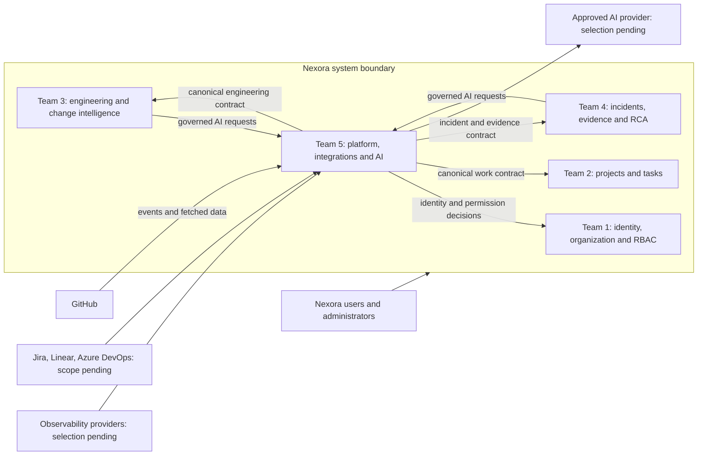
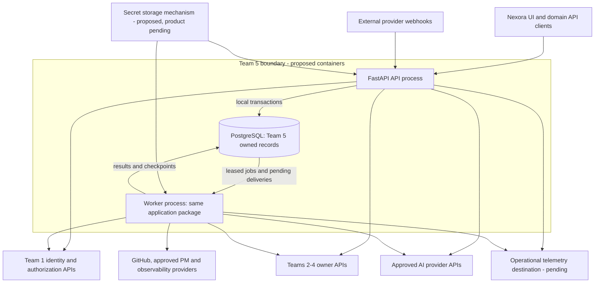
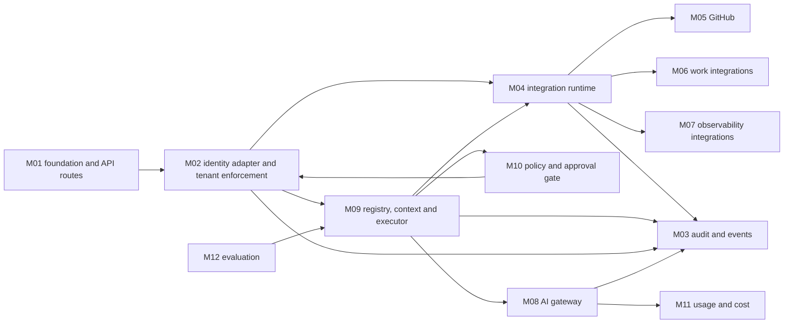
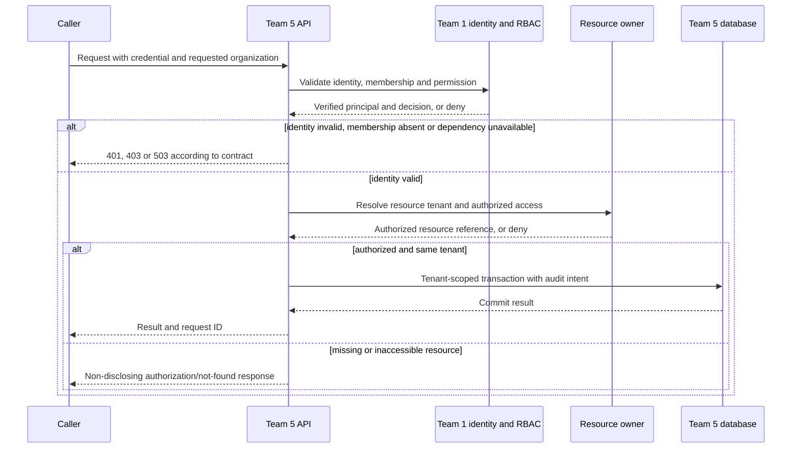
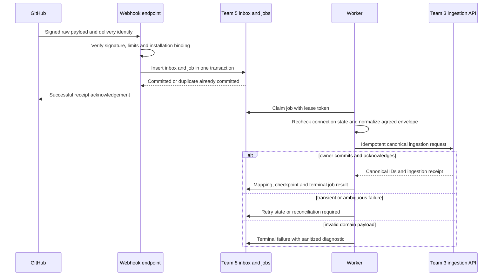

# Nexora Team 5 System Architecture

| Control | Value |
|---|---|
| Version / date | 0.1 / 2026-10-27 (Asia/Calcutta) |
| Status | Draft for review; implementation design is PROPOSED unless explicitly identified as CONFIRMED |
| Accountable owner | Sagar, Team 5 lead |
| Required reviewers | Vignesh/project coordinator; Avinash, Abhishek, Srushti and Poonam for their contracts; security/operations and QA representatives to be confirmed |
| Approval evidence | None supplied. A source requirement is not evidence that this design or a schema has been approved. |
| Related documents | [PRD](PRD.md), [contracts](api-contracts.md), [schema](database-schema.md), [security](security.md), [implementation plan](implementation-plan.md), [questions](open-questions.md), [ADRs](adr/README.md) |

## 1. Architecture overview

Team 5 provides reusable platform enforcement, connector infrastructure and governed AI infrastructure. Teams 1-4 remain the systems of record for their business data. The architecture must support three source-required chains: authorized access with audit, external data through connectors into canonical owners, and an agent through gateway, registry, authorization, policy, tool and audit. Source: `Nexora_Team5_Platform_Integrations_AI_Spec.pdf`, pp3, 18-23, sections 1, 17-22.

The supplied workspace contained no application repository, implementation, dependency manifest or deployment configuration. No existing code structure was inferred. The design below is a proposed starting structure, not a migration plan for a verified existing system.

### 1.1 Confirmed constraints and unresolved choices

| Topic | Status and implication |
|---|---|
| Team ownership | CONFIRMED from current coordinator context: Team 1 owns Organizations, Users, Authentication and RBAC; Team 2 Projects/Tasks; Team 3 engineering; Team 4 Incidents/Evidence/RCA; Team 5 shared infrastructure. |
| Historical identity conflict | Team 5 PDF pp5-6 and Team 1 PDF p14 assign authentication/RBAC to Team 5. Current coordinator direction takes precedence. Q01 requires the leads to ratify revised contracts, not build both systems. |
| High-level stack | CONFIRMED: FastAPI services and PostgreSQL, `Nexora_Product_Solution_Overview.pdf` p18 section 15. Runtime/library versions and topology are not specified. |
| Canonical engineering | Team 3 owns canonical repository, commit, PR, build and deployment models; Team 5 connector delivers owner-agreed data. Team 3 PDF pp6-7,15,20. |
| Canonical incident semantics | Team 4 owns incident interpretation/normalization and RCA; Team 5 owns external connector framework. Team 4 PDF p6 section 4. |
| AI execution | Registered tools, permission checks, policy and audit are CONFIRMED requirements; domain agents belong to Teams 3/4. Team 5 PDF pp12-14,20. |
| Human review | CONFIRMED for assisted remediation; writes are not automatically enabled by the example tool list. Team 4 PDF pp12-14; overview pp14-15. |
| Service catalog | OPEN DECISION Q05. Team 5 ERD depicts `service`; no authoritative owner/API is supplied. Do not create a Team 5 canonical service store. |
| Delivery scope | Source Team 5 scope table lists 11 P0 and 5 P1 modules although its introduction says 10/6. Q13 reconciles release scope; this design retains row priorities. |
| Capacity | Approximately two hours/person/day for three people, per user. Choose a small number of deployables and bounded work; do not equate source cycles with calendar deadlines. |

### 1.2 Proposed design and rationale

Use a modular FastAPI application, a PostgreSQL database area owned by Team 5, and a worker entry point from the same codebase for durable jobs. API and worker may run as separate processes without being separate products. Use HTTP owner APIs and versioned event envelopes for cross-team exchange; avoid direct access to another team's tables. A database-backed inbox/outbox and leased jobs provide recoverable delivery before a separate broker is justified by measured load. All of these topology choices are PROPOSED (ADR-0002/0003, Q03/Q11/Q14).

The first vertical slice is authorized access plus audit, then one GitHub-to-Team-3 path, then one read-only domain-agent tool path. Policy and permission enforcement accompany the first AI path; source development-cycle ordering is not permission to ship AI before governance. Additional providers, evaluation automation, notification channels and write tools remain gated by their source priority and open decisions.

No graph database, vector database, orchestration framework, service mesh, dedicated cache or message broker is required by the supplied sources. The organizational graph is initially a set of owner-managed relationships and references. Add infrastructure only after a measured need and an ADR. Reliability, availability, cost and recovery targets remain Q07/Q09/Q14; this document promises no numerical SLO.

## 2. C4 views and runtime interactions

These Mermaid flowcharts use C4 levels and explicit ownership rather than a renderer-specific C4 extension. Named product systems/capabilities are source-supported. Every Team 5 container, module split and transport arrow is PROPOSED; a diagram is not evidence of a deployed service.

### 2.1 System context



Sources: overview pp16,18,20; Team 5 PDF pp9-13,18-20. Observability candidates in the sources are Sentry, Datadog, PagerDuty, Prometheus and OpenTelemetry; listing them does not approve all adapters.

### 2.2 Container architecture



The secret and telemetry boxes are required capabilities with unselected products, not an infrastructure purchase or deployment decision. Whether PostgreSQL is an isolated database or restricted schema in a shared cluster is Q03; access grants must preserve owner boundaries in either case. No cross-team SQL arrow is permitted.

### 2.3 Component architecture



M09 also calls Teams 1-4 via approved context/tool adapters. M10 may narrow permissions but never grant permissions denied by Team 1 or a resource owner. Metrics/logging are cross-cutting and do not replace M03's audit records.

### 2.4 Complete request authorization



All wire details are pending CT-01. Team 5-owned resources use its own tenant-scoped lookup and the Team 1 permission decision; another team's resources require that owner's agreed access decision. A body/header organization identifier alone never establishes membership. An identity dependency outage never becomes an allow decision.

### 2.5 Webhook to canonical owner



Receipt is not canonical processing success. If the inbox transaction fails, the endpoint returns an error and must not acknowledge durable receipt. If the owner commits but its response is lost, the same idempotency key is retried or reconciled; no new canonical record is assumed. Team 3 supplies the domain validation/upsert rules.

## 3. Module responsibilities

The 16 source capability IDs are not a mandate for 16 deployed services. The proposed modules group related implementation work without changing source traceability.

| Module | Source requirement mapping | Purpose and explicit non-responsibilities |
|---|---|---|
| M01 Foundation | FR-PLAT-001; FR-OPS-001 | Configuration, request/error conventions, health/version, DB unit of work and deployment hooks. Does not own domain business rules or issue identity credentials. |
| M02 Access | FR-PLAT-002, FR-PLAT-003, FR-PLAT-004; FR-DATA-001 | Team 1 authentication adapter, permission enforcement, validated tenant context and resource checks. Does not implement login/password/session/RBAC stores. |
| M03 Audit/events | FR-PLAT-005, FR-PLAT-016; FR-REL-001 | Durable audit ingestion/query and platform event delivery. Does not replace domain activity/history or choose human notification channels without Q11. |
| M04 Connector runtime | FR-PLAT-006; FR-SEC-001, FR-SEC-002, FR-REL-001 | Provider lifecycle, credentials references, jobs, webhook inbox, external mappings and recovery. Does not own imported projects/repos/incidents. |
| M05 GitHub | FR-PLAT-007 | GitHub-specific authentication, fetch/webhook parsing, engineering envelopes and authorized read tools. Does not own repository/commit/PR/build/deployment records or automatically enable write tools. |
| M06 Work integrations | FR-PLAT-008 | Provider adapters for approved work sources, mapped into Team 2 contracts. Does not create an alternate work-management system. |
| M07 Observability | FR-PLAT-009 | Provider fetch/ingress for telemetry and incident inputs to Team 4. Does not own RCA, evidence interpretation or an unapproved canonical service catalog. |
| M08 AI gateway | FR-PLAT-010 | Approved model routing, request validation, provider adapter, timeout/failure normalization, metering hooks. Does not own domain prompts or assume provider output is a trusted action. |
| M09 Registry/executor | FR-PLAT-011, FR-PLAT-012; FR-SEC-003 | Versioned agents/tools, approved context assembly, bounded generic execution and tool dispatch. Does not implement RCA/change reasoning or arbitrary model-supplied code/URLs. |
| M10 Policy | FR-PLAT-013; FR-SEC-003 | Policy evaluation, tool risk gates, approval binding and emergency disable. Does not grant Team 1 permissions or replace Team 4 review records. |
| M11 Metering | FR-PLAT-014 | Attempt-level usage, versioned price estimates, reconciliation and derived summaries; budget gate only after Q07. Does not assert invoice accuracy or zero charge when usage is unknown. |
| M12 Evaluation | FR-PLAT-015 | Versioned fixtures and result recording infrastructure. Does not choose domain expected answers, scoring thresholds or production release acceptance without Teams 3/4. |

All module packaging and the following interface behavior are PROPOSED refinements of the mapped requirements. Exact storage fields are controlled by [database-schema.md](database-schema.md).

| Module | Inputs and outputs | Dependencies and owned data | Interfaces and failure behavior | Security, observability and test strategy |
|---|---|---|---|---|
| M01 | Environment/configuration and incoming request -> validated settings, request context, consistent response, readiness state | PostgreSQL driver, module bootstrap; no canonical business entities | Health/readiness/version and common exceptions; missing mandatory config prevents start; optional disabled adapter does not prevent core readiness | Redact settings; log startup/version and latency/error counts; test missing config, no secret disclosure, DB readiness failure and exception mapping |
| M02 | Credential, tenant selection, actor/resource/action -> verified context or explicit failure | Team 1 CT-01; owner CT-02/03/04; scoped platform settings only | Context/authorization adapter and route dependencies; invalid credential 401, denied 403 or agreed non-disclosing 404, unavailable authority 503 | Reject tenant substitution; no privileged default/service impersonation; audit denials without tokens; test IDOR, expired/revoked identities, multi-org mismatch, background rechecks and owner outage |
| M03 | Validated audit/event envelope -> durable receipt, query page, per-consumer delivery state | M01/M02, CT-06; audit_event, outbox_event, event_delivery | Authenticated ingestion/query, transactional publication and worker delivery; schema errors terminal, transient sink failure retry, exhausted retry visible | Append-only app audit privileges, tenant read authorization, field allowlist; lag/failure/redaction metrics; test duplicate receipt, crash after commit, denial and partial consumer outage |
| M04 | Provider configuration, secret reference, sync request or signed webhook -> connection/job/receipt/mapping state | M01/M02/M03; secret mechanism; integration_connection, sync_job, webhook_inbox, external_id_mapping | CT-05 plus adapter interface; invalid config fails before active; revocation disables dispatch; bounded retries and reconciliation | Egress allowlist, credential scope, tenant constraints, no arbitrary URL fetch; queue age/provider errors/lease-expiry metrics; test duplicate/out-of-order delivery, pagination, concurrent sync, crash and replay |
| M05 | Authorized GitHub connection and provider IDs -> agreed engineering envelopes, diffs/code read results | M04 and Team 3 CT-03; provider binding metadata, not canonical repositories | Adapter methods and registered tools; provider access denied -> reauthorization state; deleted repository -> owner tombstone flow; partial provider capability explicitly unavailable | Scope installation/repository allowlist; signature verification; GitHub rate-limit metrics; fixture tests for each supported event/entity, mapping and missing authors/deployments |
| M06 | Approved provider work items -> Team 2 import envelopes and returned IDs | M04 and CT-02; external mapping/checkpoint | Per-provider capability manifest; native/external conflict is owner decision, never silent overwrite | Restricted project scope; redact comments/PII before AI; count rejected mapping/status conflicts; test native/import collision, external deletion, unmapped assignee and owner rejection |
| M07 | Approved source/time range/query or provider event -> bounded telemetry/incident envelope | M04, CT-04 and service-reference Q05; source binding metadata | Separate pull telemetry from push incident adapters; empty result distinct from timeout; Team 4 canonicalizes incident interpretation | Bound query/time/size, prevent arbitrary backend query execution, verify evidence access; source freshness/partial-fetch metrics; test sensitive log redaction, truncated results, no data, rate limit and stale service mapping |
| M08 | Validated logical AI request, context and allowed route -> structured response or normalized error | M02/M03/M10/M11 and provider adapter; ai_request, ai_attempt plus model config | CT-07; timeout/unknown provider outcome recorded per attempt; no silent model/provider fallback | Provider credential never exposed; outbound classification check; route/latency/tokens/failure metrics with no prompt label; test denied model, invalid response, refusal, timeout, cancellation and metering duplication |
| M09 | Versioned agent/tool ID, permitted context references, input -> agent_run/tool_execution and typed result | M02/M03/M08/M10 and owner adapters; agent_definition, tool_definition, agent_tool, agent_run, tool_execution | CT-07; unregistered/disabled tool rejected; schema mismatch terminal; run limit/cancel stops new steps; ambiguous mutation becomes unknown | Bind org/principal/versions; validate both input/output; audit decisions and step outcomes; tests for prompt injection, forged tool names, cross-tenant context, changing arguments after approval and permission revocation |
| M10 | Principal/resource/tool/arguments digest and policy version -> allow/deny/approval-required decision | Team 1 permission result and Team 4 authoritative approval when applicable; policy_version, approval_binding | Policy API internal to execution; unavailable policy/approval authority denies execution; changed arguments invalidate approval | Explicit deny by default; approver permission and expiry verified; decision metrics and policy version audit; test stale/reused/wrong-tenant approvals, self-approval policy and disabling a running agent |
| M11 | Provider usage per attempt, price snapshot and reservations if approved -> ledger/estimate/summary | M08/M03; usage_event, model_price and derived summaries | CT-07 usage view; missing rates/usage flagged unknown; later reconciliations preserve history | Tenant and usage-read permissions; no cross-currency sums; discrepancy/reservation-leak metrics; test retry billing, duplicate reports, rounding, price changes and concurrent budget admission |
| M12 | Authorized fixture set, prompt/model/tool/policy versions and expected output -> repeatable result record | M08/M09/M11; approved evaluation data/results | Evaluation runner and report interface; invalid fixture/retrieval failure is execution error, not model-quality failure | Synthetic/redacted fixtures, no production writes from evaluator; latency/cost/grounding results; test deterministic scorer fixture, version pinning, missing evidence and restricted-data rejection |

### 3.1 Independent development boundaries

M01's skeleton, redacted error formatting and health contracts can be developed after Team 5's packaging decision. M03 envelope validation, M04 adapter interface tests, M09 schema validation and M11 cost arithmetic can be developed against explicit fixtures after internal design approval. None proves external integration complete. M02 production verification is blocked by CT-01. M05/M06/M07 canonical delivery is blocked by the respective owner contract. M08 requires model/data policy and credential approval. M09/M10 write execution is blocked by Q08 and domain approval contracts. M12 depends on Teams 3/4 evaluation fixtures and acceptance criteria. Readiness gates and small tasks are in the implementation plan.

## 4. Technology stack

| Technology/capability | Purpose | Status and evidence/rationale | Alternative or limit | Decision owner |
|---|---|---|---|---|
| FastAPI | HTTP APIs and typed route boundaries | CONFIRMED high-level choice, overview p18 | Version, async conventions and package layout pending | Vignesh/Sagar |
| PostgreSQL | Canonical relational storage and Team 5 infrastructure records | CONFIRMED high-level choice, overview p18 | Database vs schema deployment pending | Vignesh/Sagar and leads |
| Python | Implementation language for FastAPI package | PROPOSED explicit project standard; implied ecosystem is not a supplied version decision | Supported version to be pinned with dependencies | Sagar/Vignesh |
| Pydantic | Request/configuration schemas | PROPOSED for Team 5; Team 1 PDF p5 explicitly names it for Team 1 | Reuse agreed team conventions; no unvalidated arbitrary JSON settings | Sagar |
| SQLAlchemy and Alembic | Owned models, transactions and versioned migrations | PROPOSED for Team 5; Team 1 PDF p5 supports consistency | Direct SQL is possible; choose one transaction abstraction | Sagar/Vignesh |
| HTTP client with bounded timeouts | Owner/provider calls | PROPOSED; choose a maintained Python client after version review | Standard adapter hides library; do not expose client objects to domain modules | Sagar |
| PostgreSQL inbox/outbox/jobs | Durable asynchronous operations with minimal infrastructure | PROPOSED ADR-0002; fits current staffing | Broker later if measured throughput/independent consumers require it | Sagar/Vignesh |
| OpenTelemetry instrumentation | Correlated operational traces | PROPOSED; source lists OpenTelemetry as integration candidate, which does not approve this instrumentation deployment | Structured logs initially if trace backend undecided | Sagar/operations |
| Secret storage and TLS termination | Credentials and encrypted transport | Required security capabilities; product/platform OPEN Q06/Q14 | Managed secret service or an approved deployment-native secret mechanism; no plaintext DB fields | Coordinator/security/operations |
| Testing and packaging tools | Unit, contract, integration, migration and security checks | PROPOSED pytest-compatible stack, pinned manifest and reproducible build | Existing organization standards, if later supplied, take precedence | Sagar/QA |

No versions, cloud provider, Kubernetes cluster, cache, broker, commercial AI model or SaaS observability subscription is selected here. External technical references supplement implementation recommendations and do not change project scope: FastAPI supports modular routers ([official guidance](https://fastapi.tiangolo.com/tutorial/bigger-applications/)); PostgreSQL supports row locking with `SKIP LOCKED`, useful for a queue-like work claim but not a general consistency guarantee ([official SELECT documentation](https://www.postgresql.org/docs/current/sql-select.html)).

## 5. Repository and code organization

PROPOSED structure after Q03. No directories below are claimed to exist except the documentation delivered in this task. If a real repository is supplied, compare its layout and adopt these boundaries without blindly moving files.

```text
docs/                       PRD, contracts, architecture, schema, security, ADRs
src/nexora_platform/
  app.py                    FastAPI composition and startup
  worker.py                 same-package durable job worker entry point
  foundation/               M01 settings, errors, request context, health
  access/                   M02 Team 1 adapter and tenant enforcement
  audit_events/             M03 audit, outbox and delivery
  integrations/
    core/                   M04 lifecycle, capabilities, jobs, inbox, mappings
    github/                 M05 provider adapter
    work/                   M06 approved provider adapters
    observability/          M07 approved provider adapters
  ai/
    gateway/                M08 provider abstractions and logical requests
    registry_runtime/       M09 definitions, context and execution
    policy/                 M10 gates and approval bindings
    usage/                  M11 attempt ledger and estimates
    evaluation/             M12 fixture/run infrastructure
  contracts/                versioned owner/provider DTOs and client adapters
  persistence/              engine/session setup and owned shared primitives
migrations/                 Team 5-only reviewed schema changes
tests/
  unit/                     pure policies/parsers/arithmetic
  contracts/                provider/consumer agreement fixtures
  integration/              real PostgreSQL and stub owner/provider services
  security/                 isolation, webhook, tool and redaction attacks
  recovery/                 restart, lease and replay scenarios
deploy/                     approved environment templates and runbooks
```

Each module owns its routes, service logic, schemas, repositories and tests. Routes authenticate/validate and delegate; services express use cases; repositories require validated organization context. `contracts/` holds transport representations and adapters, not duplicate ORM definitions for Teams 1-4. `persistence/` has no generic unrestricted repository that can bypass tenant filters. `integrations/core` holds common lifecycle semantics; provider-specific pagination, signatures and rate limits stay in provider adapters. `ai/registry_runtime` does not contain Team 3/4 reasoning or domain result stores. `deploy/` excludes credentials. Tests use synthetic fixtures, never captured secrets or unredacted production logs.

## 6. API design standards

Source-specified intended paths are enumerated in CT-05/CT-07; no deployed endpoints were verified. Payload schemas, status/error behavior and the following conventions are PROPOSED. Versioned `/api/v1` paths are supported as intent by Team 5 PDF p16. `/health`, `/ready`, `/version` are source-specified on p5.

| Area | Proposed rule and verification |
|---|---|
| Resources/version | Plural nouns, stable opaque IDs, `/api/v1`; breaking semantic/schema changes require a new agreed version. Test existing consumer fixtures against new producers. |
| Request validation | Typed body, allowlisted filters/sorts, bounded strings/arrays and body size; reject unknown sensitive configuration keys. Parameter limits are approved configuration under Q09. |
| Response | Resource JSON with stable IDs and UTC timestamps; use explicit `null`/unknown states instead of fabricated values. Async operations return a durable operation ID and accepted state; receipt is not completion. |
| Pagination | Opaque cursor over stable `(created_at,id)` order scoped to organization/filter set. Never put secret content in cursor. Define default/max page sizes before release. |
| Errors | Stable machine code, safe message, request ID, optional safe field details and retryability. Never return raw exception, SQL, provider response body or credential. |
| Request/correlation IDs | Generate trusted request ID; accept only validated bounded correlation context. Record causal links on jobs/events. IDs carry no authority. |
| Authentication | Consume Team 1-issued/validated identity under CT-01. Headers, cookies, JWT/introspection and delegation mechanism remain Q01. Browser CSRF/CORS rules follow the selected credential mechanism. |
| Authorization | Recheck tenant and action/resource permission at use; 401 for invalid identity, 403 for known denied action, agreed non-disclosing 404 where resource existence must be hidden. 503 for unavailable authority. |
| Rate limits | Per principal/tenant/provider scopes and bounded concurrency; 429 with safe retry indication. Quota values require Q07/Q09. Avoid a global tenant-visible capacity leak. |
| Idempotency | For job creation/import/write commands, persist tenant + operation + caller idempotency key and request digest; same key/body returns original operation, changed body conflicts. Expiry must exceed supported replay horizon. |
| Documentation | OpenAPI generated from approved schemas and consumer contract fixtures; examples explicitly synthetic. Authorization dependencies must be documented, not hidden in middleware. |
| Compatibility | Add optional fields cautiously; consumers tolerate unknown optional fields but fail closed on unknown permission/policy semantics. Publish version/retirement agreement with affected leads; no invented deprecation period. |

Illustrative request for the source-specified sync path; headers and body are proposals pending CT-01/CT-05:

```http
POST /api/v1/integrations/connection-example/sync
Authorization: Bearer <Team-1-issued-credential>
Idempotency-Key: sync-example-001
Content-Type: application/json

{"mode":"incremental"}
```

```json
{
  "job_id": "job-example",
  "integration_id": "connection-example",
  "status": "queued",
  "request_id": "request-example"
}
```

Organization is derived from the verified context and stored connection; it is not accepted from an unchecked body. The example `integration_id` is the public resource identifier for the proposed `integration_connection` record. Exact CT-05 schema must be approved before code generation.

```json
{
  "error": {
    "code": "DEPENDENCY_UNAVAILABLE",
    "message": "Authorization could not be established.",
    "retryable": true,
    "request_id": "request-example"
  }
}
```

Validation failures use agreed field paths and safe messages. Provider authentication failure is not confused with caller authentication failure. GET/list results are tenant-filtered before pagination and totals; do not fetch everything then hide rows after pagination.

## 7. Cross-team integration architecture

All transports below are proposed, owner-authenticated APIs/events. Direct database reads or cross-team physical foreign keys are not assumed.

| Contract/owner | Data flow and system of record | Identity and authorization | Failure/retry/observability | Agreement required |
|---|---|---|---|---|
| CT-01 / Team 1, Avinash | Identity, user/employee mapping, organization membership and permission decisions -> M02; security events -> M03. Team 1 owns users, orgs, RBAC, sessions and credential lifecycle. | Verify issuer/audience or introspection contract; user and service identity distinguished; delegated actor bound to tenant and scope. | Invalid identity denied; unavailable authority blocks sensitive use. Bounded cache, if approved, must have revocation semantics; trace decision ID without tokens. | Token mechanism, service identity, revocation, user/employee IDs, resource-check responsibility and auth endpoint migration (Q01/Q02). |
| CT-02 / Team 2, Abhishek | Work context -> authorized context/tool requests; connector envelopes -> owner import/update. Team 2 persists canonical project/task and decides workflow/conflicts. | Actor permission plus project/task tenant verified by owner. Organizational allocation is not permission. | Retry only idempotent owner commands with stable key; unmapped assignment or conflicting native state becomes explicit rejection/review. Record owner receipt/correlation. | Canonical import, source direction, status mapping, delete policy, membership versus T1 allocation (Q02/Q04). |
| CT-03 / Team 3, Srushti | GitHub adapter -> canonical repository/branch/commit/PR/build/deployment ingest; owner context -> AI tools. Team 3 persists engineering data and analysis. | Connection installation scope plus owner tenant binding and caller repository permission; external Git authors stay external until resolved. | Stable provider IDs scoped to connection/entity; duplicate/out-of-order handling owner-agreed; checkpoints after receipt; trace lag and rejected versions. | IDs, canonical fields/versions, ingestion/upsert semantics, owner dedup, repository-to-project-to-org relationship (Q02/Q04/Q05). |
| CT-04 / Team 4, Poonam | Provider telemetry/incident envelopes -> Team 4; authorized evidence/context and domain approval references -> runtime; AI result -> Team 4 workflow. | Evidence and incident access checked at owner; technical approval binding refers to authenticated authoritative review. | Partial data returns provenance/completeness, not invented evidence. Owner outage stops affected tool; write ambiguity enters unknown/reconciliation. | Incident normalization boundary, source credential split, service references, evidence bounds and approval semantics (Q04/Q05/Q08/Q10). |

Each consumer contract suite must include allowed, denied, wrong-tenant, deleted/missing, unavailable, duplicate and incompatible-version cases. Owner IDs are opaque until Q02 resolves type conventions. Team 5 stores references and integration mappings; it never becomes the fallback source of truth when an owner is unavailable. Contract mocks enable parallel development but production readiness requires joint integration evidence.

## 8. Database architecture

The proposed data dictionary, constraints and ERD reconciliation are in [database-schema.md](database-schema.md). This section establishes architecture invariants; no executable DDL is delivered or approved.

Team 5 owns tenant settings, provider/connection configuration, secret references, synchronization jobs/checkpoints, inbound delivery identity, external ID mappings, telemetry-source bindings, model/provider configuration, versioned agent/tool/policy definitions, AI requests/attempts/runs/executions, usage/pricing metadata and audit/event delivery. It does not own organization/user/role/project/task/repository/commit/PR/incident/evidence/RCA records. `service` remains blocked by Q05.

Every tenant-owned row carries `organization_id`; local references enforce same-tenant relationships through composite keys where appropriate. Globally shared provider metadata must be explicitly classified global and contain no tenant secrets. A provider catalog ID never confers access to another organization's connection. Business IDs are logical owner references verified through CT-01..04, not invented cross-database constraints. Internal identifier type, external key scope and timestamp precision require Q02/Q15.

The supplied Team 5 ERD is reconciled rather than copied: `organization` becomes a Team 1 reference; `github_repository` becomes binding metadata to Team 3; external project/task records become mappings or separately approved transient ingestion snapshots; `service` is withheld; credential blobs become secret references; raw prompt/response and tool input/output persistence is not enabled by default. Additional `ai_attempt`, `agent_run`, approval binding and inbox/outbox records are proposed to fill lifecycle gaps. The schema document explains each change and source.

Transaction boundaries are local: mutate a platform record and insert its audit/outbox intent in one transaction; insert inbox and associated job atomically; claim a lease atomically; persist provider attempt identity before network dispatch; write final execution outcome with its audit intent. Never hold a DB transaction open across a provider/model/owner call. Owner ingestion must itself commit data and dedup receipt atomically. There is no distributed transaction and no exactly-once guarantee across systems.

Uniqueness includes tenant and relevant connection/entity scope. Index tenant + list order, pending status/next-attempt, connection + checkpoint/history, request/run references and tenant/time audit filters. Index decisions require query-plan review with representative data; do not index raw sensitive payloads. Mutable records use revision checks to prevent concurrent lost updates. Connection disabling is a state transition, not destructive cascade.

Migrations are versioned, reviewed and tested both from empty DB and supported previous schema. Use expand/backfill/contract for incompatible changes, measure backfill impact, and check tenant constraints before enabling new code. Application rollback must remain compatible with expanded schema; destructive rollback is not an automatic response to deployment failure. Retention, deletion propagation and legal hold mechanisms remain Q10. Retain only approved minimal references after source deletion, prevent new access, and record reconciliation status; do not cascade deletions into another team's store.

## 9. Authentication, authorization and tenant isolation

The required logical path is identity -> organization membership -> action permission -> resource authorization -> policy -> operation -> audit. For AI tools, add tool allowlist/version and approval when required. Sources: Team 5 PDF pp6-7,12,14,20 and current coordinator ownership; wire contracts pending.

1. The trust boundary receives a user credential or approved service credential. Validate it through Team 1's agreed mechanism; if signed tokens are selected, verify signature, trusted issuer/audience, expiry and required claims using the approved rotation policy. Do not build a separate token issuer.
2. Resolve an immutable request context with actor type, user/service ID, organization ID, delegated user if any, permission context/version and correlation IDs. Keep `employee_id` optional and separate from `user_id`. A caller cannot supply a more privileged actor in JSON.
3. Confirm active organization membership and account status; validate selected organization even for multi-org users. Verify each resource belongs to that organization through the owner or tenant-scoped local query. Lists, exports, nested resources, caches, jobs and summary aggregates use the same scope.
4. Ask the authority for the required permission and enforce resource rules. Team 5's policy can restrict an allowed action but cannot override a denial. Team 2 project membership and Team 1 allocation must not be equated until their contract is agreed.
5. Service credentials identify the service and granted operations. On-behalf-of calls carry independently verifiable delegation, not a forged user header. Scheduled sync may use a tenant-scoped approved service principal; user-initiated tools retain user-bound authority. No implicit universal service principal.
6. Revalidate identity/permission/connection/policy at worker execution and immediately before side effects. Do not persist long-lived bearer tokens in jobs. A revoked or disabled actor, tool, agent or connection prevents new steps; in-flight provider effects require reconciliation.
7. Return safe denial and record authorization failure where required. A failed audit write must not turn a denial into permission. Sensitive mutations require durable audit intent before dispatch; ordinary non-sensitive-read audit outage handling requires explicit risk agreement (Q10/Q14).

Any authorization cache requires a documented maximum stale interval, tenant/principal/resource/policy key, revocation mechanism and fail-closed behavior for sensitive actions. Until CT-01 approves it, do not cache allow decisions. PostgreSQL row-level security is optional defense in depth, not a replacement for application/owner checks. If adopted, application roles must not bypass it; owner/superuser bypass and pooled-session context leakage must be tested. [PostgreSQL's row-security documentation](https://www.postgresql.org/docs/current/ddl-rowsecurity.html) describes these privilege limits.

## 10. Integration framework

The source connector interface is `authenticate()`, `connect()`, `disconnect()`, `health_check()`, `sync()`, `fetch()`, `handle_webhook()` (Team 5 PDF p9). PROPOSED refinement: each adapter declares supported capabilities, authentication type, allowed hosts, payload/event types, checkpoint strategy, rate-limit rules and whether fetch/sync/webhook operations are supported. Unsupported methods return an explicit capability error; no dummy success.

Connection states are `pending`, `active`, `degraded`, `disabled`, `disconnected`. Configuration validation and credential binding precede activation. Provider failure may degrade a connection; revoked/expired credentials stop dispatch until reauthorized. Disable blocks new work and cancels queued work where safe. Disconnect revokes or detaches credential access, stops new work and retains only policy-approved history. Reconnection must not accidentally replay obsolete writes.

Job states are `queued`, `running`, `retry_wait`, `succeeded`, `failed`, `cancelled`. Every transition is conditional on current state/revision and lease owner. A job records checkpoint, attempt count, next attempt and sanitized failure reason. Success means owner persistence was acknowledged for the declared scope; partial pages remain resumable. Concurrent jobs for the same connection/scope are serialized or reconciled under an explicit adapter rule.

Webhook processing limits raw bytes before parsing, locates the expected connection secret through server configuration, verifies provider signature and binding, checks allowed event type/schema, then inserts durable inbox identity. For GitHub use signature verification over the received raw bytes and a constant-time digest comparison; do not sign reserialized JSON. This is provider-specific guidance, not a generic signature algorithm for all connectors. [GitHub's webhook validation documentation](https://docs.github.com/en/webhooks/using-webhooks/validating-webhook-deliveries) supports that mechanism. A delivery ID is a dedup key, not authentication; signature validity alone does not determine tenant ownership.

Use provider-supported delivery identifiers plus connection/tenant scope for deduplication. If the provider has no event ID, the adapter must specify a stable semantic key and its collision/replay limitations. Do not invent a signed timestamp check where the provider does not supply one. Validate installation/repository identifiers against the connection's authorized scope. Retained raw payloads require classification, encryption/access and retention approval; otherwise store minimal validated envelope and hash.

Fetching uses provider-specific pagination and rate-limit metadata, bounded page/result size, cancellation and egress allowlists. Follow pagination/redirect targets only within approved hosts. Normalize transport fields into owner-agreed contracts; domain interpretation remains owner code/specification. A full resync reconciles missing records only using owner-approved deletion semantics, never deletes solely because one provider page failed.

PM import is initially a proposed one-way flow into Team 2, pending Q04; bidirectional updates introduce conflict and write authorization requirements and are not implied. Observability differs: telemetry may be queried for a bounded time window; provider incidents may be pushed; OpenTelemetry is not automatically an incident-management API. Select adapters and scope individually.

## 11. AI gateway, agents and tools

### 11.1 Gateway lifecycle

The gateway accepts a logical request with verified principal/organization, purpose, context provenance, approved model policy, prompt/template version and bounded input/output limits. Model/provider selection comes from approved configuration, not an arbitrary model-supplied URL. Validate allowed data classification and model capability before dispatch. Provider credentials resolve only inside the adapter. Source-required functions are routing, authentication, handling, retry/timeout, usage/cost/logging/policy (Team 5 PDF p11).

PROPOSED execution order: authorize -> policy/data checks -> reserve budget if enabled -> create logical request and attempt -> provider call -> validate structured response -> reconcile usage -> persist outcome/audit -> return result. Refusals, unsupported features, provider authentication errors, throttling, invalid output and timeout remain distinct errors. A provider timeout can have unknown billable usage. Never report it as zero cost or automatically repeat a side effect.

Provider adapters expose capability metadata and normalized usage/error structures. Retry only failures classified safe for that provider and operation, within an overall deadline and attempt cap. Record each actual provider attempt, even if the logical request is retried. Fallback to a different provider/model requires an explicit approved route that permits its data handling and cost; no silent fallback. Cancellation stops new work and attempts provider cancellation if supported; it does not prove no provider charge or completed remote effect.

### 11.2 Registry and bounded agent execution

Tool definitions include name, description, version, input/output schema, required permission, supported resource type, risk level and audit requirement (source metadata: overview p15; Team 5 p12). PROPOSED additions: fixed server-side handler binding, allowed connection/resource scopes, timeout, idempotency capability and approval requirement. An agent definition pins its version, allowed tools, context builder and execution limits. The agent-tool relation is many-to-many; enabling a tool does not bypass per-call permission checks.

A run binds principal, organization, agent/prompt/tool/policy/model versions, context references and provenance. Teams 3/4 own domain prompts, expected output and business results. Context assembly calls owner APIs under the same principal, tags source/time/authorization provenance and distinguishes missing, stale, truncated and denied data. It does not copy all domain databases into Team 5. Content available to one tenant/principal is never reused for another without reauthorization.

The runtime uses a bounded loop with approved step, token, elapsed-time and tool-call limits; values require Q07/Q09. Persist state between durable steps. Detect cancellation/disablement before each new step. A model can propose tool arguments, but a deterministic dispatcher decides whether the call is permitted. Tool output is validated and treated as untrusted context. Domain schemas should distinguish evidence, inference and unknown where applicable; Team 4 owns that domain result model.

### 11.3 Tool authorization and approval

```mermaid
sequenceDiagram
  participant R as Agent runtime
  participant M as Model through gateway
  participant G as Tool authorization gate
  participant A as Team 1 and resource owner
  participant P as Authoritative review or policy
  participant T as Registered tool handler
  M-->>R: Proposed tool name and arguments
  R->>G: Versioned proposal with run context
  G->>G: Registry lookup, schema and scope validation
  G->>A: Current actor, tenant and resource permission
  A-->>G: Allow or deny
  G->>P: Policy and exact approval proof when required
  P-->>G: Allow, deny or approval required
  alt any check fails or required approval missing
    G-->>R: Denied or awaiting approval; no tool effect
  else every check passes
    G->>G: Persist execution and durable audit intent
    G->>T: Fixed handler with validated arguments
    T-->>G: Validated result or unknown outcome
    G-->>R: Audited outcome
  end
```

Effective tool authority is the intersection of user/delegated service permissions, tenant/resource access, agent allowlist, tool policy, connection scope and current approval. Model text never grants authority. Retrieved code, logs, comments and incident descriptions are untrusted data; instructions within them cannot alter system policy, choose a new handler or disclose credentials. Fixed outbound destinations, structured schemas and authorization protect execution even if an injection fools the model's reasoning.

Tool states are `pending`, `awaiting_approval`, `running`, `succeeded`, `failed`, `unknown`, `cancelled`. Approval binding is a technical reference to authoritative human review, not a second approval system. Bind actor, organization, exact tool/version, normalized argument digest, target resource/version, policy version, expiry and approver authority. Changes to any bound fact require reapproval. Before dispatch, verify approval is valid and atomically consume/claim it against the execution; recheck current permissions. Prevent concurrent reuse.

A crash after remote dispatch but before recording its result produces `unknown`; do not replay a write unless the target supports the same idempotency key or an authorized reconciliation proves non-execution. A valid approval alone does not make retries safe. The initial production-capable path is advisory/read-only; branch/commit/PR/test execution tools require explicit Q08 scope and execution isolation. No arbitrary shell, generated-code execution, merge or production deploy is enabled by the existence of tool examples. Team 4's initial remediation remains proposal -> human review.

### 11.4 Metering, budgets and evaluation

Meter every actual provider attempt with organization, actor, agent, model/provider, request count, latency, input/output tokens when known, timestamp and price snapshot. Preserve estimated versus provider-reported usage. Price uses explicit currency/unit/effective version; unknown pricing produces unknown cost. Derived summaries are rebuildable from the ledger and never authoritative independent balances. Duplicate ingestion of usage must not duplicate charges; multiple genuine retries are separate attempts. Reconciliation appends corrections with provenance rather than silently rewriting history.

Budget enforcement is PROPOSED and blocked by Q07. If enabled, concurrent requests must atomically reserve an upper-bound estimate, settle actual reported usage and retain/reconcile uncertain reservations after timeout. A hard ceiling cannot be promised where a provider's charging/outcome is unknown. Product must choose fail-closed behavior and allowed overrun exposure. Usage summaries alone cannot enforce budgets safely.

Evaluation is P1/eventual source scope (Team 5 p15). Store prompt/model/tool/policy versions, fixture provenance, expected/actual result references, scorer version, score, latency and cost. Teams 3/4 provide approved domain fixtures and thresholds. Run synthetic/redacted data first; evaluation tools cannot trigger real external mutations. Failures distinguish infrastructure, invalid fixture and quality result. No claimed accuracy, grounding percentage or release threshold is supplied by the sources.

## 12. Audit, events and observability

Audit records and domain events have different purposes. Audit describes actor/action/resource/outcome and supports investigation. Events notify consumers of state transitions; each domain owner defines its own business event. Team 4 investigation history remains authoritative for RCA workflow. Team 5 PDF p8 lists example event types; exact schemas/delivery guarantees are pending CT-06/Q11.

Proposed event envelope includes event ID, schema version, producer, organization, actor type/ID when appropriate, event type, resource type/ID, occurred-at/recorded-at, correlation/causation IDs and a typed minimized payload. Actor IDs are references, not proof of identity; authenticate producer and validate authority before ingestion. Preserve source event identity for dedup. Mark organization-unknown authentication failures explicitly rather than assigning them to a guessed tenant; restrict such security records to approved platform operations access.

Write audit intent atomically with sensitive local changes and before dispatching sensitive remote actions. Worker completion writes outcome audit. Append-only application privileges prevent ordinary updates/deletes; this is not a claim of WORM storage or protection against database administrators. Export, retention, legal hold and stronger tamper evidence require Q10/Q14. Audit reads are tenant- and permission-scoped and audited themselves where policy requires.

Use outbox_event plus event_delivery per consumer for at-least-once delivery. Consumers deduplicate and own their transaction. Delivery can repeat after a crash; ordering is only promised for an agreed key/sequence, never globally. Failed consumers do not prevent other consumers from progressing. Durable failed state and authorized replay replace silent loss. Notifications are an optional consumer with channel/preference/content requirements unresolved; no email/chat sending implementation is approved merely by PLAT-016.

Operational logs use timestamp, severity, component/version, request/correlation/run/job IDs, safe error code and outcome. Exclude tokens, passwords, secret values, authorization headers, raw prompts/responses, full webhook payloads and unapproved sensitive evidence. Allowlisted fields and test canaries are preferable to relying only on regex redaction. IDs may still be sensitive and follow retention/access policy.

Metrics cover request latency/errors, authorization dependency failures, tenant-check denials, inbox/job age, retries/terminal failures, provider throttling, owner-ingest rejection, agent/tool outcomes, model latency/usage and audit delivery lag. Avoid unbounded labels such as user IDs, raw resource IDs, prompts and exception strings. Trace request -> job/event -> owner/provider call with causal links; telemetry backend is pending. OpenTelemetry's trace model supports span relationships and propagation ([official documentation](https://opentelemetry.io/docs/concepts/signals/traces/)); adopting a collector/backend remains a separate decision.

Operational alerts require owners and thresholds before release (Q09/Q14): sustained authorization failure, audit backlog, expired leases, terminal ingestion failures, provider credential failure, unexpected usage growth and recovery errors. A runbook must show how to locate a correlation ID, inspect sanitized state, check owner/provider receipt, disable a connection/tool, replay safely and record reconciliation. No on-call commitment is invented.

## 13. Reliability and failure handling

| Failure | Proposed response | Required verification |
|---|---|---|
| Team 1 or owner authorization unavailable | Deny affected operation with safe dependency error; no fallback allow/cache expansion | Inject timeout and verify no data/side effect escapes |
| PostgreSQL unavailable before commit | Reject writes/receipts; readiness fails; do not acknowledge durable enqueue | Fail DB during inbox and audit transaction |
| Worker crashes before claim commit | Another worker can claim unclaimed work | Restart with concurrent workers |
| Worker dies after claim | Lease expires; safe read/idempotent work may be reclaimed using new fencing token | Expire lease; old worker cannot commit checkpoint under stale token |
| Worker dies during remote mutation | Mark/recover as unknown; reconcile target receipt before retry | Crash after remote effect before local result; verify no duplicate mutation |
| Provider 429/transient 5xx | Honor valid retry indication; capped exponential backoff with jitter and total deadline; bound retries per adapter | Deterministic test clock and retry budget assertions |
| Provider invalid credentials/permission | Stop retries until credential/scope changes; mark connection degraded/disabled as appropriate | Verify no retry storm or token disclosure |
| Bad event/schema/version | Reject before processing or persist quarantined diagnostic if already accepted; explicit operator action | Poison payload cannot starve unrelated work |
| Duplicate/out-of-order event | Durable dedup plus owner version/sequence policy; reread current provider state if agreed | Replay and reverse-order fixtures preserve canonical state |
| Owner commits but acknowledgement lost | Retry same idempotency key or query ingestion receipt | Simulate lost response and verify one owner effect |
| Model call times out | Record unknown provider outcome/usage; bounded safe retry only if policy allows | Each actual attempt tracked; unknown never reported as zero |
| Event consumer outage | Per-consumer retry/failed state; other deliveries progress; replay authorized and audited | One consumer down, another succeeds |
| Secret rotated during job | Resolve current permitted version at dispatch; allow approved verification overlap only for webhook rotation | Old credential stops outbound use; valid overlap and revocation cases tested |

All external calls have connect/read/total deadlines and cancellation propagation; approved configuration defines numerical values and retry caps. Retry loops at multiple layers must share one attempt budget rather than multiply attempts. No retry for validation/authorization failures without a state change. A circuit breaker is optional after evidence of need; it must not hide permanent credential failures.

The job worker claims eligible records transactionally, sets owner/lease expiry/fencing token, releases the DB transaction, performs work, and updates only under its current token. Heartbeats extend active leases within an overall run deadline. Lease expiry is not proof a remote side effect did not occur. Checkpoints advance only after an owner receipt is durable. Reconciliation has bounded scope, authorization, audit and the same dedup rules as normal processing.

Recovery requires database backup/restore, tested secrets availability, schema/version compatibility, inbox/outbox replays and provider/owner reconciliation. RPO/RTO, backup frequency, encryption, restore destination and operator ownership remain Q14. A successful database restore alone is not proof that external side effects and billing are reconciled.

## 14. Deployment architecture and operations

PROPOSED environments: isolated local development, shared integration/staging and production only after release approval. Names/topology/cloud/vendor are not confirmed. Use synthetic data locally and in automated tests; production credential/data access is not needed for onboarding.

| Concern | Proposed implementation requirement | Release gate |
|---|---|---|
| Configuration | Typed settings, explicit environment, allowed provider hosts, issuer/audience or identity endpoint, DB connection, enabled feature flags, request limits/deadlines, redaction and telemetry controls | Reject missing mandatory settings and unsafe defaults; Q01/Q06/Q09 |
| Secrets | Resolve runtime references with least privilege; never build into image/repository or return through configuration API | Chosen secret store, rotation/revocation exercise; Q06 |
| Startup | Validate settings, dependency versions and migration compatibility; initialize clients without performing destructive work | No automatic schema recreation or external write on startup |
| Health/readiness | `/health` indicates process liveness; `/ready` checks essential local capability/DB/schema; `/version` exposes safe build metadata | Tests distinguish dependency-specific degradation from total process failure |
| Migration | One controlled migration actor; acquire deployment coordination lock; verify backups and expanded schema compatibility before application rollout | Reviewed migration and rollback/recovery evidence; Q03/Q14 |
| API and worker | Same versioned artifact with different entry points; restricted DB credentials and provider egress; configurable worker concurrency | Lease/restart and graceful shutdown tested |
| Shutdown | Stop new requests/claims, drain within configured deadline, leave recoverable leases/unknown outcomes; flush bounded telemetry | Forced termination recovery test |
| Release | Run unit/contract/security/migration/recovery tests, deploy to staging, run the three source chains with owner leads, verify dashboards/audit/health, then production gate | No mock-only declaration of integration complete |
| Rollback | Roll back compatible application artifact; disable newly failing adapters/tools; preserve durable records; forward-fix data with reviewed migration | Do not blindly reverse destructive data migrations or replay uncertain writes |
| Operations | Named operational contact, alert routes, incident escalation, backup/restore and credential rotation runbooks | Q14 unresolved means production operation remains blocked |

Deployment must not require every external provider to be healthy for `/ready` if the local platform can safely serve unrelated functions. Report module/provider health separately and reject operations depending on failed authority. Public health responses contain no secret, internal topology or unnecessary build details. Browser/API admin surfaces, if added, require accessibility and authorization acceptance agreed with the product owner; no new frontend stack is selected.

## 15. Architecture decision records and implementation gates

See [ADR index](adr/README.md). ADR-0001 records the current ownership direction and historical conflict. ADR-0002 through ADR-0006 propose topology, canonical exchange, gated AI execution, minimized retention/metering and contract-based delivery. No ADR is stakeholder-approved by this authoring task.

Before approved implementation moves past fixtures, resolve the applicable questions: Q01/Q02 identity and identifiers; Q03 topology; Q04 owner ingestion; Q05 service catalog; Q06 provider/secret/egress; Q07 models/budgets; Q08 approval; Q09 capacity/SLOs; Q10 retention; Q11 event/notification delivery; Q12 evaluation; Q13 scope; Q14 operations; Q15 schema reconciliation; Q16 assignment/QA roster. The implementation plan classifies each task's gate. An unresolved question blocks only the affected capability, but cannot be disguised as a finished integration.
