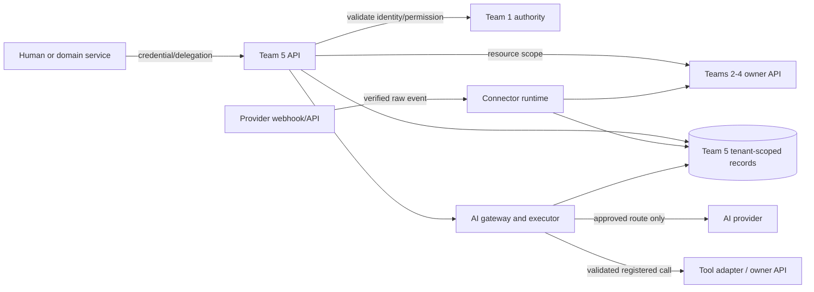

# Nexora Team 5 security and governance design

Version 0.1 | 2026-10-27 | Status: **PROPOSED implementation controls; no security review, compliance certification, provider selection or production deployment is claimed**

Related: [PRD](PRD.md), [architecture](architecture.md), [API contracts](api-contracts.md), [database schema](database-schema.md), [open questions](open-questions.md), [implementation plan](implementation-plan.md).

## 1. Security objective and authority boundary

Team 5 must make connector and AI actions no more privileged than the authorized principal and resource owner permit. The coordinator assigns identity, organizations, users and RBAC to Team 1; Team 5 consumes that authority and enforces the result. Team 5 does not create an alternative account, password, token, session, role or permission-grant store. This resolves the current target boundary while retaining the historical conflict in Q01. [S00; S06 pp5-7,20; S02 p14]

**CONFIRMED requirements:** least privilege and tenant context; central audit; registered tools with input/output schemas, required permission, risk and audit metadata; no AI authorization bypass; human review for assisted remediation; no automatic merge/deploy by default. [S01 pp14-16; S05 pp12-14; S06 pp6-15,20]

All implementation details below are **PROPOSED** until the relevant owner accepts CT-01 through CT-07 and Q01-Q16. This is a practical threat model, not a claim that every listed control exists.

## 2. Security invariants

| ID | Invariant | Enforcement and proof |
|---|---|---|
| SEC-I01 | An unauthenticated, invalid, expired or revoked identity causes no protected action. | Validate through CT-01 before business handling; service outage fails closed; test forged/expired/wrong-audience/revoked cases. |
| SEC-I02 | A tenant selector never proves tenant membership. | Derive tenant from verified identity or verified provider connection; check owner resource tenant; test header/body/payload substitution. |
| SEC-I03 | An agent cannot exceed its delegated human/service, domain-resource, tool and policy grants. | Effective permission is their intersection; recheck before every tool and resumed job; test user/agent parity and revocation after enqueue. |
| SEC-I04 | Model output and retrieved content are untrusted data, never executable authority. | Server maps a versioned tool to reviewed code and validates inputs/outputs; test prompt injection and forged approval claims. |
| SEC-I05 | Credentials, raw tokens and secrets do not enter normal database fields, API responses, logs, traces, prompts or audit metadata. | Store a secret reference only; use redaction/canary scans; test failed calls and debug paths. |
| SEC-I06 | No acknowledged webhook/job/event is silently lost; an uncertain side effect is not blindly replayed. | Durable receipt/intent, scoped idempotency, leases and reconciliation; crash-point and duplicate tests. |
| SEC-I07 | Audit evidence is tenant-scoped, provenance-preserving and separately controlled from routine logs. | Append-only application permission, actor/resource/outcome/correlation fields, metadata allowlist; test unauthorized query/update and redaction. |
| SEC-I08 | An assisted write executes only the exact, current, approved operation. | Bind approval to tenant, actor, tool/version, resource revision, argument digest, policy and expiry; atomically consume it; test mutation/reuse/race/revocation. |

## 3. Trust zones and data flows

The client, external provider, model provider and another domain service are separate trust zones. `Team 5 API` is not automatically trusted merely because it is internal; service-to-service calls require workload authentication, audience restriction and explicit operation/tenant scope. The database is trusted only through least-privilege application principals. The model provider has no direct database, secret store, internal network or tool access. A provider token authenticates the provider, not a Nexora user.

## 4. Threat model and required mitigations

Likelihood has no source baseline and is intentionally not scored. “Gate” references the question or requirement that must close before affected live behavior.

| Threat | Primary assets / consequence | Required behavior | Test evidence | Gate |
|---|---|---|---|---|
| Forged, replayed or oversized webhook | Tenant integrity, engineering/incident truth, worker capacity | Enforce body limit; verify exact raw bytes with provider-specific secret/signature; use constant-time comparison; bind installation/connection to tenant; store dedupe identity before acknowledgment; reconcile replay separately. | Valid known-answer signature; one-byte mutation; duplicate, wrong installation/tenant, oversized body and DB-failure tests. | FR-SEC-002, Q06/Q09/Q10 |
| Credential/token theft or accidental disclosure | Provider/data access, model billing | Secret reference only; runtime least-privilege retrieval; redact errors/traces; prohibit raw config/prompt/audit storage; rotate/revoke on disconnect. | Canary-secret scan across logs/responses/database fixtures; denied secret retrieval; rotation and rollback rehearsal. | FR-SEC-001, Q06/Q10/Q14 |
| Server-side request forgery through connector or tool input | Internal endpoints and secrets | Provider adapter controls destination; allowlist scheme/host/port; validate redirects and resolved address; no client/model-supplied arbitrary URLs or paths. | Metadata/private IP, redirect, DNS rebinding simulation and malformed URL tests. | FR-SEC-001, Q06 |
| Cross-tenant IDOR / confused deputy | Other organization data/action | Trusted principal/connection supplies tenant; every lookup, cache, job, mapping, event and output result is tenant scoped; owner validates external resource. | Two-tenant direct/API/worker/cache/webhook tests; same external ID in both tenants; delegated-agent parity. | FR-PLAT-003/004, FR-DATA-001, Q01/Q02 |
| Stale authorization / background privilege retention | Unauthorized delayed tool/sync action | Bind initiating actor/delegation to job/run; revalidate current permission, connection and policy before dispatch/continuation; fail closed when authority unavailable. | Revoke membership/tool/policy after enqueue; verify no later provider/owner call. | FR-PLAT-003/012/013, Q01/Q08 |
| Prompt injection / unsafe tool orchestration | Exfiltration, unauthorized write, false conclusion | Treat logs/code/tickets/tool output as untrusted; separate trusted instructions from data; validate typed tool calls server-side; fixed adapter allowlist; no model-chosen code/URL/tenant/policy. | Adversarial corpus asks to reveal secret, override policy, call cross-tenant resource, fabricate approval and fetch URL; assert zero prohibited calls. | FR-SEC-003, FR-PLAT-011-013 |
| Tool argument, version or approval substitution | Incorrect external change | Version immutable definitions; bind approval to exact digest/tool/resource revision/actor/tenant/policy/expiry; atomic consume; reauthorize just before dispatch. | Argument change, tool upgrade, expired/reused/wrong-tenant approval, concurrent consume and revoked reviewer tests. | FR-PLAT-013, Q08 |
| Provider/model data overexposure | Sensitive code, evidence or PII leaving controlled boundary | Approved provider/model route and data-class policy required; minimize context; prevent silent fallback; redact/avoid retention; log metadata only. | Route denied by tenant/data class; fallback blocked; context limit and prompt canary tests. | FR-PLAT-010, Q06/Q07/Q10 |
| Duplicate, out-of-order or uncertain side effect | Duplicate domain data, model cost or external mutation | Idempotency scope + request fingerprint; durable receipt; lease fencing; checkpoint after owner receipt; unknown state triggers reconciliation, not blind retry. | Crash before/after send/receipt; duplicate concurrent claim; changed body same key; provider timeout with possible success. | FR-REL-001, Q04/Q09 |
| Audit tampering or sensitive audit export | Forensic integrity / privacy | Append-only app permission; scoped audit reads; producer identity/event IDs; field allowlist; controlled retention/purge; audit sensitive audit reads. | Unauthorized update/delete/export; duplicate producer event; raw token/PII canary; retention purge test after policy. | FR-PLAT-005, Q10/Q11 |
| Resource exhaustion / expensive AI or provider call | Availability, cost | Bound body/context size, tool steps, wall time, concurrency, provider calls and retries; rate and quota behavior after Q07/Q09; backpressure and fail-safe queues. | Load/admission, cancellation, retry-budget and budget-race tests; measure targets only after agreed baseline. | FR-PLAT-010/012/014, Q07/Q09 |
| Insecure migration, backup or restore | Broad data exposure or duplicate operations | Separate migration/runtime privileges; verified backup encryption/access; isolated restore; reconcile jobs and revoke stale credentials before side effects resume. | Clean deploy, failed migration, restore and controlled replay rehearsal. | FR-OPS-001, Q03/Q10/Q14 |

## 5. Mandatory control checklist

### Identity, authorization and tenancy

- [ ] CT-01 defines token/session validation, issuer/audience or introspection, expiry, revocation, user status, service identity, delegation, tenant membership and outage behavior.
- [ ] API, worker, webhook, event consumer, tool dispatcher and status-result paths use the same tenant/authorization boundary.
- [ ] Resource authorization is checked with the owner team; Team 5 does not infer permission from Team 1 allocation or Team 2 membership until Q16 resolves the relation.
- [ ] A disabled connection, revoked policy, disabled tool or revoked subject stops newly claimed/retried work.
- [ ] Authorization/cache keys include tenant, subject/actor type, resource/action and policy version; no allow cache exists before its revocation semantics are approved.
- [ ] Failure behavior is non-disclosing for inaccessible cross-tenant resources and does not downgrade unavailable authority into allow.

### Provider connections, secrets and webhooks

- [ ] Credential configuration contains opaque secret reference/version only; database JSON, logs and responses exclude secret material.
- [ ] Each adapter declares capabilities and allowed egress destinations; unsupported capability is explicit.
- [ ] Secret rotate flow stages, validates, switches, audits and retires safely; disconnect revokes future retrieval and cancels pending dispatch.
- [ ] Webhook handler checks raw body size before parsing, authenticates before queueing, uses an adapter-defined verifier and binds the delivery to trusted connection metadata.
- [ ] Webhook receipt/dedupe uses provider delivery identity and payload digest; signature verification does not falsely imply freshness or dedupe.
- [ ] Provider errors are categorized without raw credentials/response dumps. Retry respects provider rate guidance and is bounded.

### API and persistence

- [ ] Validate schema, field size/depth and identifiers before expensive work; reject unknown security-relevant fields.
- [ ] All Team 5 tenant rows and local relations carry/enforce organization scope; cross-team IDs are opaque logical references, not direct foreign-table writes.
- [ ] Idempotency is bound to tenant + actor + operation + canonical body; same key/different body conflicts.
- [ ] A worker holds no database transaction across remote calls; lease/fencing prevents stale worker update; completion/checkpoint needs receiver acknowledgment.
- [ ] Database runtime role cannot run migrations or broad admin actions. Optional PostgreSQL row-level security is defense in depth; if used, test owner/superuser bypass and connection-pool context reset.
- [ ] Restore/runbook includes external reconciliation and dedupe, not only database recovery.

### AI gateway, registry and tool execution

- [ ] Provider/model/tenant route is approved before dispatch; no silent provider fallback or provider-selected tool access.
- [ ] Registry version includes schemas, required permission, risk, audit requirement, operation kind and fixed trusted handler key.
- [ ] Tool schema validation happens before and after execution; output is untrusted when fed back into a model.
- [ ] Agent runs enforce approved step, deadline/context/concurrency/budget limits and record source provenance/missing context.
- [ ] Advisory is the default; high-risk action requires current authorization, policy and an exact human approval binding. Automatic merge/deploy stays disabled.
- [ ] Usage records logical request and physical provider attempt separately; missing/uncertain usage or price remains unknown.
- [ ] Evaluation uses approved synthetic/redacted cases by default; no automatic model/tool promotion based on a score.

### Audit, observability, privacy and operations

- [ ] Audit captures safe actor type/ID, tenant, action, resource reference, outcome/reason, occurrence/receipt time and correlation; excludes credential/raw content by default.
- [ ] Logs/metrics/traces are structured and redacted; diagnostic access is authorized; a correlation ID is not a secret.
- [ ] Alerts/health distinguish platform health, queue/lease health, identity authority, provider degraded state and domain-owner failure.
- [ ] Retention, residency, deletion, legal hold, backup purge and export behavior are approved under Q10/Q14 before customer data.
- [ ] Release requires source-aware contract, security, migration/recovery and cross-team chain evidence; component fakes are labeled as such.

## 6. Security tests and release evidence

| Test group | Minimum evidence | Requirement bundle |
|---|---|---|
| Identity / tenant | invalid, expired, revoked and wrong-tenant identities; direct and queued resource checks; user/agent parity | TC-PLAT-002/003/004, TC-DATA-001 |
| Webhook / connector | signature mutation, delivery replay, body limit, wrong connection, rate limit, disconnect-before-run, crash/retry | TC-SEC-001/002, TC-PLAT-006/007, TC-REL-001 |
| AI / tool | denied model/context/tool, adversarial injection, schema mismatch, disabled versions, cancellation, approval binding/race | TC-PLAT-010-013, TC-SEC-003 |
| Audit / privacy | unauthorised audit read/update, duplicate event, metadata redaction, canary secret, retention behavior | TC-PLAT-005/016, TC-SEC-001 |
| Reliability / operations | lease expiry, duplicate job/attempt, unknown external outcome, restore, migration failure and controlled replay | TC-REL-001, TC-OPS-001, E2E-04 |

No test in this document has been executed against an application: none exists in the inspected workspace. Passing a mock validates a component boundary, not a provider, owner service, production permission, data policy or release.

## 7. Incident response and exceptions

**PROPOSED response order:** stop affected adapter/model/tool with a configuration disable; preserve sanitized request/connection/run/audit identifiers; revoke or rotate suspected credential; identify affected tenant/resource scope; reconcile unknown deliveries/executions without automatic replay; notify the accountable operational/domain owner through the agreed channel; record a post-incident decision. Do not dump raw prompts, provider payloads or credentials into tickets.

Emergency override is not specified by the sources. If one is needed, it must be a separately approved break-glass design with named authority, strict scope/time, immutable audit and post-use review. A generic platform administrator or an AI agent must not become an undocumented bypass.

The security exception process is also **OPEN DECISION**: an exception needs owner, affected tenant/resource, reason, compensating controls, expiration, approval and audit record. It cannot weaken Team 1 permissions, bypass Team 4 human review, or silently change a registered tool/policy version.
